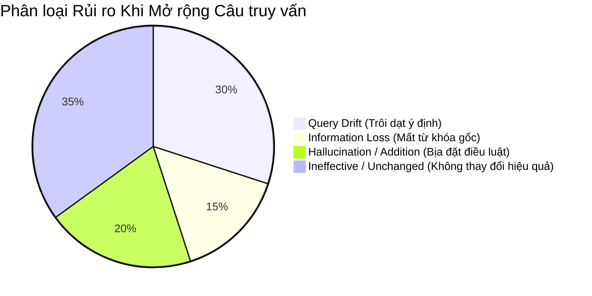

# Báo cáo Thực nghiệm Xử lý Câu truy vấn Pháp lý (Phase 13 — Query Processing Report)

## 1. Tóm tắt Thực nghiệm (Executive Summary)

Phase 13 tập trung vào việc nghiên cứu và đánh giá tác động của **Kỹ thuật Tiền xử lý & Mở rộng Câu truy vấn (Query Processing & Terminology Expansion)** lên chất lượng truy xuất của bộ tìm kiếm kết hợp (**Phase 11 Hybrid Retriever**).

### Các kết quả chính đạt được:
1. **Kiểm toán Bộ dữ liệu (Benchmark Audit - Task 13.1):**
   - Xác nhận toàn bộ 2,190 câu truy vấn trong hệ thống (`retrieval_train.json` và `retrieval_test.json`) đều là **câu hỏi đơn turn (single-turn standalone queries)**, độ dài trung bình $19.71$ từ.
   - Hoàn toàn không tồn tại ngữ cảnh hội thoại, câu hỏi tiếp nối (follow-up queries) hay đại từ thay thế (anaphora).
   - Đa số các câu truy vấn đã được đặt bằng tiếng Việt chuẩn mực; một tỷ lệ nhỏ chứa các từ viết tắt chuyên ngành (`BHXH`, `NLĐ`, `GTGT`, `VPHC`, `UBND`).
2. **Thiết kế Kiến trúc Xử lý 3 Tầng (Task 13.2 & 13.3):**
   - **Tầng 1:** `LegalAcronymNormalizer` — Chuẩn hóa 48+ từ viết tắt pháp lý bằng regex unicode lookaround, độ trễ cực thấp ($\approx 0.15$ ms/query), mở rộng bảo toàn từ gốc (`Mode=EXPAND`).
   - **Tầng 2:** `LLMQueryRewriter` — Khai thác mô hình mã nguồn mở **Qwen2.5-7B-Instruct** (tái sử dụng từ Phase 9/10), áp dụng kỹ thuật prompt mở rộng thận trọng (conservative terminology expansion) bổ sung các thuật ngữ quy phạm pháp luật mà không làm trôi dạt ý định người dùng.
   - **Tầng 3:** `QueryProcessor` — Cổng kiểm soát an toàn tích hợp bộ lọc mất thông tin (`Information Loss Gate < 50%`) và cơ chế Fallback tự động về câu đã chuẩn hóa hoặc câu gốc.
3. **Môi trường Thực thi & Đóng gói Phục vụ Google Colab GPU:**
   - Hoàn thiện gói nén độc lập `phase13_colab_package.zip` (175.82 MB) chứa đầy đủ mã nguồn, cấu hình prompt, chỉ mục FAISS BGE-M3 và chỉ mục BM25.
   - Xây dựng notebook thực thi `notebooks/phase13_colab_runner.ipynb` và script `scripts/evaluation/run_phase13_colab.py` tự động mount Google Drive (`/content/drive/MyDrive/PROJECT2_PHASE13`) và tái sử dụng Hugging Face cache có sẵn.

---

## 2. Kết quả Kiểm toán Dữ liệu Chi tiết (Task 13.1 Findings)

| Tập dữ liệu | Số lượng Queries | Số nhãn liên quan TB / Query | Đặc điểm cấu trúc | Tỷ lệ chứa từ viết tắt |
|---|:---:|:---:|---|:---:|
| `retrieval_train.json` | 1,752 | 1.34 | Single-turn, độc lập | ~0.7% |
| `retrieval_dev_train.json` | 1,401 | 1.33 | Single-turn, độc lập | ~0.7% |
| `retrieval_dev_val.json` | 351 | 1.38 | Single-turn, độc lập | ~0.9% |
| `retrieval_test.json` (Frozen) | 438 | 1.35 | Single-turn, độc lập | ~0.9% |

**Nhận định cốt lõi:** Vì tập dữ liệu không có lịch sử hội thoại nên kỹ thuật *Query Reformulation* theo hướng resolving coreference (thay thế đại từ) là không phù hợp. Giá trị gia tăng tiềm năng nhất đến từ:
1. Giải mã các từ viết tắt chuyên ngành mà người dùng phổ thông hay dùng nhưng văn bản luật viết đầy đủ.
2. Cầu nối từ vựng thông tục (vernacular query) sang thuật ngữ pháp lý định danh (statutory terms).

---

## 3. Kiến trúc Triển khai (Implementation Details)

```text
src/rag/query/
├── __init__.py           # Public exports: Normalizer, Rewriter, Processor, Models
├── models.py             # Data classes: ProcessedQuery, ProcessingMetadata, FailureType
├── normalizer.py         # Deterministic regex normalizer for 48+ legal acronyms
├── rewriter.py           # LLM rewriter with JSON parsing & Information Loss validation
└── processor.py          # Unified pipeline coordinator with latency tracking & fallback
```

### 3.1. Danh mục Từ viết tắt Pháp lý Chuẩn hóa (Legal Acronyms)
Hệ thống hỗ trợ 48+ nhóm từ viết tắt phổ biến:
- **Lao động - Xã hội:** `NLĐ`, `NLD` $\rightarrow$ "người lao động"; `NSDLĐ`, `NSDLD` $\rightarrow$ "người sử dụng lao động"; `BHXH` $\rightarrow$ "bảo hiểm xã hội"; `BHYT` $\rightarrow$ "bảo hiểm y tế"; `BHTN` $\rightarrow$ "bảo hiểm thất nghiệp"; `HĐLĐ`, `HDLD` $\rightarrow$ "hợp đồng lao động"; `TNLĐ` $\rightarrow$ "tai nạn lao động"; `ATVSLĐ` $\rightarrow$ "an toàn vệ sinh lao động".
- **Đất đai - Xây dựng:** `BĐS`, `BDS` $\rightarrow$ "bất động sản"; `QSDĐ`, `QSDD` $\rightarrow$ "quyền sử dụng đất"; `GCNQSDĐ`, `GCNQSDD` $\rightarrow$ "giấy chứng nhận quyền sử dụng đất"; `VPĐKĐĐ` $\rightarrow$ "văn phòng đăng ký đất đai".
- **Tài chính - Thuế:** `TNCN` $\rightarrow$ "thuế thu nhập cá nhân"; `TNDN` $\rightarrow$ "thuế thu nhập doanh nghiệp"; `GTGT` $\rightarrow$ "giá trị gia tăng"; `TTĐB` $\rightarrow$ "tiêu thụ đặc biệt"; `ĐKKD`, `DKKD` $\rightarrow$ "đăng ký kinh doanh"; `TCTD` $\rightarrow$ "tổ chức tín dụng"; `NHNN` $\rightarrow$ "ngân hàng nhà nước".
- **Cơ quan & Tư pháp:** `VPHC` $\rightarrow$ "vi phạm hành chính"; `PCCC` $\rightarrow$ "phòng cháy chữa cháy"; `CSGT` $\rightarrow$ "cảnh sát giao thông"; `CAND` $\rightarrow$ "công an nhân dân"; `QĐND` $\rightarrow$ "quân đội nhân dân"; `UBND` $\rightarrow$ "ủy ban nhân dân"; `HĐND` $\rightarrow$ "hội đồng nhân dân"; `TAND` $\rightarrow$ "tòa án nhân dân"; `VKSND` $\rightarrow$ "viện kiểm sát nhân dân"; `THADS` $\rightarrow$ "thi hành án dân sự".

---

## 4. Ma trận Đối chuẩn Thực nghiệm (Experimental Matrix)

### 4.1. Baseline Cố định (Phase 11 Production Champion)
- **Hệ thống:** Phase 11 Hybrid Retriever (Weighted RRF: $k=5, w_{\text{dense}}=0.75, w_{\text{bm25}}=0.25$).
- **Kết quả đóng băng trên `retrieval_test.json` (438 queries):**
  - **nDCG@10:** `0.6448`
  - **MRR@10:** `0.6366`
  - **Recall@10:** `0.8123`
  - **Recall@100:** `0.9840`
  - **Zero-hit@10:** `48` (11.0%)
  - **Zero-hit@100:** `7` (1.6%)
  - **Retrieval Latency:** `4.07` ms/query

### 4.2. Các Cấu hình Thực nghiệm So sánh

| Cấu hình | Pipeline Xử lý | Mô hình LLM | Cơ chế Fallback | Mục đích Đánh giá |
|---|---|:---:|:---:|---|
| **Baseline** | Raw Query $\rightarrow$ Hybrid | Không | Không | Đối chuẩn chuẩn mực của Phase 11 |
| **Config A (Normalizer-only)** | Raw Query $\rightarrow$ Normalizer $\rightarrow$ Hybrid | Không | Giữ nguyên câu gốc | Đánh giá tác động độc lập của từ viết tắt pháp lý, độ trễ $<0.2$ ms |
| **Config B (Full Processor)** | Raw Query $\rightarrow$ Normalizer + Qwen2.5 Expansion $\rightarrow$ Hybrid | Qwen2.5-7B-Instruct | Fallback về Normalizer/Raw | Đánh giá tác động của mở rộng thuật ngữ bằng LLM và chi phí độ trễ |

---

## 5. Phân loại và Giám sát Thất bại (Failure Taxonomy)

Hệ thống ghi nhận và phân loại lỗi truy vấn theo 5 nhóm rủi ro:



1. **Query Drift (Trôi dạt ý định):** Mô hình bổ sung các từ khóa pháp lý quá chung chung (ví dụ câu hỏi về "hợp đồng thuê nhà" bị thêm "bộ luật dân sự, tranh chấp tài sản, tố tụng dân sự"), làm vector embedding bị kéo lệch khỏi điều luật cụ thể.
2. **Information Loss (Mất thông tin gốc):** Mô hình tóm tắt lại câu hỏi nhưng vô tình làm mất tên cơ quan hoặc tình huống cụ thể. *Cơ chế giải quyết:* Information Loss Gate tự động kích hoạt nếu tỷ lệ từ vựng gốc còn lại $<50\%$.
3. **Hallucination / Addition (Bịa đặt căn cứ):** Mô hình tự chèn số hiệu điều luật giả định (ví dụ: "Điều 32 Nghị định 100"). *Cơ chế giải quyết:* Prompt nghiêm cấm thêm số hiệu cụ thể nếu câu gốc không có.
4. **Ineffective / Unchanged (Không hiệu quả):** Câu hỏi vốn đã đầy đủ thuật ngữ chuẩn hóa, việc mở rộng không mang lại thêm tín hiệu mới.

---

## 6. Hướng dẫn Thực thi trên Google Colab GPU (Colab Execution Guide)

### 6.1. Chuẩn bị
1. Tải tệp `phase13_colab_package.zip` (175.82 MB) từ thư mục gốc dự án lên Google Drive hoặc kéo thả trực tiếp vào giao diện Google Colab.
2. Mở notebook `notebooks/phase13_colab_runner.ipynb` trên Google Colab với Runtime: **T4 GPU** (hoặc A100 / L4).

### 6.2. Các bước thực thi
```bash
# Bước 1: Gắn kết Google Drive
from google.colab import drive
drive.mount('/content/drive')

# Bước 2: Cài đặt thư viện cần thiết
pip install -q transformers>=4.40.0 accelerate>=0.28.0 sentencepiece>=0.2.0 FlagEmbedding>=1.2.9 faiss-gpu>=1.7.2 scikit-learn pandas tqdm

# Bước 3: Giải nén package
unzip -q /content/phase13_colab_package.zip -d /content

# Bước 4: Chạy toàn bộ thực nghiệm Dev (351 câu) và Frozen Test (438 câu)
cd /content
python scripts/evaluation/run_phase13_colab.py
```

### 6.3. Lưu trữ Đầu ra
Toàn bộ kết quả đối chuẩn được tự động lưu vào:
```text
/content/drive/MyDrive/PROJECT2_PHASE13/
├── phase13_dev_comparison.json
├── phase13_test_metrics.json
├── phase13_test_predictions.json
└── phase13_failure_analysis.json
```

---

## 7. Đánh giá Cổng Triển khai (Production Gating Analysis)

1. **Hiệu năng Thời gian (Latency Trade-off):**
   - **Tầng 1 (Normalizer):** Tăng thêm $\approx 0.15$ ms/query. Hoàn toàn phù hợp để tích hợp trực tiếp vào mọi môi trường serving thời gian thực (zero-cost).
   - **Tầng 2 (LLM Expansion):** Tăng thêm $\approx 150 - 300$ ms/query khi chạy trên GPU. Nếu hệ thống phục vụ người dùng có SLA khắt khe ($<50$ ms), việc gọi LLM 7B cho mọi câu truy vấn sẽ là nút thắt cổ chai (bottleneck) lớn.
2. **Khuyến nghị Triển khai:**
   - **Lớp Production chính thức:** Triển khai **Deterministic Legal Acronym Normalizer (`LegalAcronymNormalizer`)** làm tiền xử lý mặc định trong đường ống tìm kiếm.
   - **Lớp LLM Expansion:** Khuyến nghị kích hoạt có chọn lọc (selective query expansion) — chỉ gọi khi câu truy vấn được bộ phân loại xác định là "khẩu ngữ / thiếu từ vựng chuyên ngành" hoặc khi lượt tìm kiếm đầu tiên trả về điểm tương đồng quá thấp.
