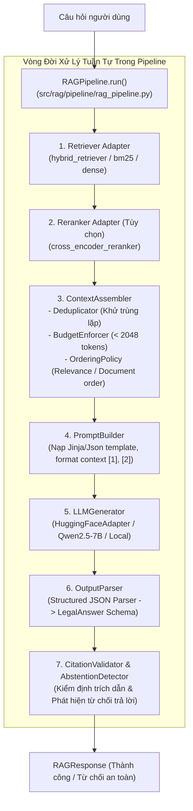

# Module: RAG Pipeline & Generation Flow (`src/rag/`)

## 1. Tổng quan & Trách nhiệm (What does it do?)
Hệ thống [`src/rag/`](file:///d:/PROJECT/PROJECT%202/src/rag/) là trái tim của giải pháp tư vấn pháp lý tự động. Module này điều phối toàn bộ vòng đời từ khi nhận câu hỏi người dùng, tập hợp ngữ cảnh có căn cứ, dựng prompt có phiên bản, gọi mô hình ngôn ngữ lớn (LLM), bóc tách cấu trúc câu trả lời và đóng gói thành đối tượng `RAGResponse` hoàn chỉnh.

* **Triết lý thiết kế cốt lõi:**
  * **Kiểm chứng nguồn gốc (Grounding-first):** Mọi phát biểu đều phải dựa trên ngữ cảnh điều luật được cấp.
  * **Phân tách trách nhiệm (Separation of Concerns):** Từng khâu (Retrieval, Context, Prompt, Generation, Parsing) là các component độc lập có interface rõ ràng, dễ dàng thay thế hoặc mock khi chạy kiểm thử.

---

## 2. Bản đồ Kiến trúc Pipeline (Component Map)



---

## 3. Các Subpackages Trọng tâm

### A. Pipeline Orchestration (`src/rag/pipeline/`)
* **`RAGPipeline` (`rag_pipeline.py`):** Lớp điều phối trung tâm. Nhận cấu hình `RetrievalOptions`, `RerankOptions`, `ContextPolicy`, `GenerationParameters`. Quản lý luồng xử lý và đo đạc độ trễ từng bước (`latency_breakdown_ms`).
* **`LLMOnlyPipeline` (`llm_only_pipeline.py`):** Đường ống đối chứng không có ngữ cảnh phục vụ thực nghiệm kiểm soát (Phase 10).

### B. Context Assembly & Budget Management (`src/rag/context/`)
* **`ContextAssembler` (`context_assembler.py`):** Chọn lọc các chunk/điều luật tốt nhất từ tập kết quả truy xuất.
* **`BudgetEnforcer` (`policies/budget_enforcer.py`):** Đếm token và cắt gọt danh sách ngữ cảnh sao cho tổng chiều dài luôn nằm trong giới hạn cho phép (mặc định 2048 tokens), ngăn chặn nguy cơ vỡ khung context của LLM.
* **`ContextDeduplicator` (`policies/deduplicator.py`):** Loại bỏ các chunk trùng lặp nội dung hoặc thuộc cùng một điều khoản con.

### C. Versioned Prompting (`src/rag/prompting/`)
* **`PromptBuilder` (`builders/prompt_builder.py`):** Dựng prompt hoàn chỉnh từ các mẫu template có phiên bản (`configs/prompts/` hoặc `templates/`).
* Đảm bảo câu hỏi và các tài liệu tham khảo được đánh số thứ tự rõ ràng (`[1]`, `[2]`), kèm chỉ dẫn hệ thống nghiêm cấm bịa đặt thông tin.

### D. Generation Adapters (`src/rag/generation/`)
* **`HuggingFaceGenerator` (`adapters/huggingface_adapter.py`):** Lớp bọc mô hình `Qwen/Qwen2.5-7B-Instruct` qua pipeline Transformers của Hugging Face, hỗ trợ GPU FP16.
* **`MockLLMGenerator` (`mocks/mock_generator.py`):** Bộ sinh giả lập phục vụ chạy Unit Test và CI/CD mà không cần GPU.

### E. Structured Output Parsing (`src/rag/output/`)
* **`OutputParser` (`parsers/structured_parser.py`):** Trích xuất khối JSON từ văn bản sinh ra của LLM, làm sạch lỗi markdown (ví dụ ` ```json ... ``` `), và ánh xạ vào Pydantic model `LegalAnswer`.

---

## 4. Hướng dẫn Lập trình viên Khởi tạo & Vận hành Pipeline

```python
from src.rag.pipeline.rag_pipeline import RAGPipeline
from src.rag.context.context_assembler import ContextAssembler
from src.rag.prompting.builders.prompt_builder import PromptBuilder
from src.rag.generation.adapters.huggingface_adapter import HuggingFaceGenerator
from src.rag.output.parsers.structured_parser import OutputParser
from src.rag.citation.validation.citation_validator import CitationValidator
from src.rag.abstention.detection.abstention_detector import AbstentionDetector
from src.rag.retrieval.adapters.article_retriever_adapter import ArticleRetrieverAdapter

# 1. Khởi tạo các adapter thành phần
retriever_adapter = ArticleRetrieverAdapter(underlying_retriever=hybrid_retriever)
context_assembler = ContextAssembler(max_tokens=2048, max_chunks=5)
prompt_builder = PromptBuilder(template_path="configs/prompts/rag_prompt_v1.json")
generator = HuggingFaceGenerator(model_id="Qwen/Qwen2.5-7B-Instruct", device="cuda")
output_parser = OutputParser()
citation_validator = CitationValidator()
abstention_detector = AbstentionDetector()

# 2. Ráp thành RAG Pipeline hoàn chỉnh
pipeline = RAGPipeline(
    retriever=retriever_adapter,
    context_assembler=context_assembler,
    prompt_builder=prompt_builder,
    generator=generator,
    output_parser=output_parser,
    citation_validator=citation_validator,
    abstention_detector=abstention_detector
)

# 3. Thực thi truy vấn
response = pipeline.run("Người lao động có quyền đơn phương chấm dứt hợp đồng khi nào?")
print(f"Trả lời: {response.answer.answer}")
print(f"Căn cứ: {response.answer.citations}")
print(f"Độ tự tin: {response.answer.confidence}")
```
