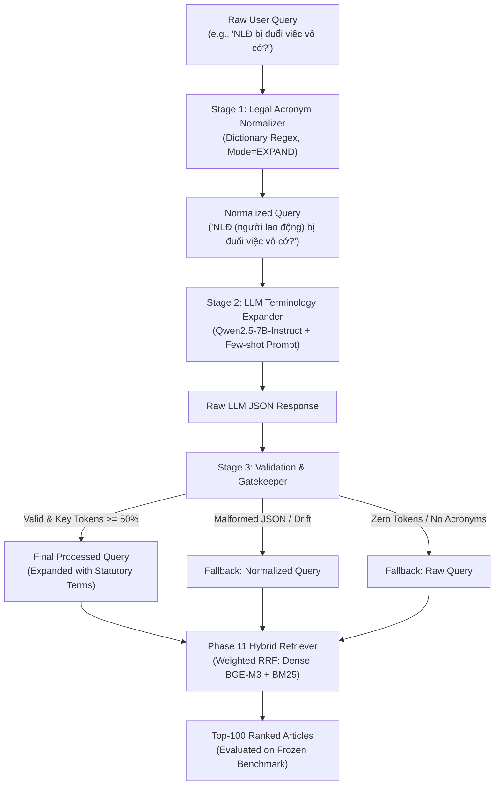

# Đặc tả Kỹ thuật Xử lý Câu truy vấn Pháp lý (Phase 13 — Query Processing Specification)

## 1. Giới thiệu & Mục tiêu (Executive Summary)

### 1.1. Bối cảnh
Trong hệ thống truy xuất văn bản pháp luật Việt Nam (**Vietnamese Legal Document Intelligence System**), câu hỏi của người dùng thực tế thường có độ phân hóa từ vựng rất lớn so với ngôn ngữ quy chuẩn của các văn bản quy phạm pháp luật:
- **Từ viết tắt chuyên ngành & hành chính:** Người dùng thường gõ tắt như `TNCN` (thuế thu nhập cá nhân), `BĐS` (bất động sản), `BHXH` (bảo hiểm xã hội), `NLĐ` (người lao động), `NSDLĐ` (người sử dụng lao động), `VPHC` (vi phạm hành chính), `PCCC` (phòng cháy chữa cháy), `CSGT` (cảnh sát giao thông).
- **Khẩu ngữ & Ngôn ngữ thông tục:** Người dùng thường dùng từ đời thường như "bị đuổi việc vô cớ", "sang tên sổ đỏ", "đòi nợ thuê", "vượt đèn đỏ", trong khi điều luật sử dụng các thuật ngữ chuẩn hóa như "đơn phương chấm dứt hợp đồng lao động trái pháp luật", "đăng ký biến động quyền sử dụng đất", "không chấp hành hiệu lệnh của đèn tín hiệu giao thông".

### 1.2. Mục tiêu Phase 13
1. **Thiết kế và triển khai module Query Processing 3 tầng (Three-stage Pipeline):**
   - **Tầng 1 (Deterministic Legal Acronym Normalizer):** Chuẩn hóa từ viết tắt pháp lý bằng từ điển chuyên ngành với regex boundary chính xác cao, không phụ thuộc LLM, độ trễ $<0.2$ ms.
   - **Tầng 2 (Controlled Legal Terminology Expansion):** Mở rộng thuật ngữ pháp lý có kiểm soát sử dụng LLM **Qwen2.5-7B-Instruct** (kế thừa từ Phase 9/10), áp dụng kỹ thuật prompt thận trọng (conservative rewriting) và few-shot in-context learning.
   - **Tầng 3 (Validation & Safe Fallback):** Cổng kiểm duyệt cấu trúc JSON, phát hiện mất thông tin (Information Loss Gate $>50\%$), phân loại lỗi và kích hoạt cơ chế rút lui an toàn (Safe Fallback).
2. **Đánh giá thực nghiệm Downstream Retrieval Impact:**
   - Đo lường tác động trực tiếp của Query Processing lên **Phase 11 Hybrid Retriever** (Weighted RRF $k=5, w_{\text{dense}}=0.75, w_{\text{bm25}}=0.25$).
   - Tuyệt đối không tinh chỉnh trên test set: Development experiment chạy trên `retrieval_dev_val.json` (351 câu); Frozen Test Evaluation chạy trên `retrieval_test.json` (438 câu).
3. **Phân loại lỗi chuyên sâu (Failure Taxonomy):**
   - Phân tích Query Drift, Information Loss, Hallucination/Addition, và Ineffective/Unchanged.
4. **Chuẩn bị môi trường thực thi Google Colab GPU:**
   - Script chạy trọn vẹn, tự động mount Google Drive (`/content/drive/MyDrive/PROJECT2_PHASE13`), tái sử dụng cache Hugging Face của `Qwen/Qwen2.5-7B-Instruct` và `BAAI/bge-m3`.

---

## 2. Kiến trúc Hệ thống Query Processing



---

## 3. Chi tiết Thiết kế Các Tầng (Component Specifications)

### 3.1. Tầng 1: Deterministic Legal Acronym Normalizer (`LegalAcronymNormalizer`)
- **Tập tin:** `src/rag/query/normalizer.py`
- **Nguyên lý:**
  - Từ điển pháp lý gồm 48+ từ viết tắt thông dụng trong các lĩnh vực: Lao động & BHXH (`NLĐ`, `NSDLĐ`, `BHXH`, `BHYT`, `HĐLĐ`), Thuế & Tài chính (`TNCN`, `TNDN`, `GTGT`, `TCTD`), Đất đai (`BĐS`, `QSDĐ`, `GCNQSDĐ`), Hành chính & Giao thông (`VPHC`, `PCCC`, `CSGT`), Cơ quan nhà nước (`UBND`, `HĐND`, `TAND`, `VKSND`).
  - Hỗ trợ cả biến thể có dấu và không dấu (ví dụ `NLĐ` và `NLD`, `BĐS` và `BDS`, `QSDĐ` và `QSDD`).
  - Xử lý biên từ tiếng Việt chính xác với regex lookaround unicode: `(?<![a-zA-Z0-9àá...])ACR(?![a-zA-Z0-9àá...])`, triệt tiêu hoàn toàn false positives (ví dụ: không nhận diện nhầm từ "Đồng" thành "HĐ").
  - Chế độ mở rộng mặc định: `NormalizationMode.EXPAND` — giữ nguyên từ viết tắt gốc và bổ sung nghĩa mở rộng trong dấu ngoặc đơn: `NLĐ (người lao động)`. Điều này giúp bộ truy xuất từ vựng (BM25) bắt được cả từ viết tắt lẫn từ đầy đủ, đồng thời giúp Dense Bi-Encoder hiểu trọn vẹn ngữ nghĩa.
- **Đặc tính hiệu năng:** Độ trễ thực thi cực nhỏ ($\approx 0.15$ ms/query), hoàn toàn không tốn tài nguyên GPU.

### 3.2. Tầng 2: Controlled Legal Terminology Expansion (`LLMQueryRewriter`)
- **Tập tin:** `src/rag/query/rewriter.py`
- **Cấu hình Prompt:** `configs/prompts/query_rewriter_v1.json`
- **Mô hình mục tiêu:** `Qwen/Qwen2.5-7B-Instruct`
  - Tham số sinh: $T = 0.0$ (Greedy decoding), `max_new_tokens = 256`, `do_sample = False`, `seed = 42`.
- **Nguyên tắc Conservative Expansion:**
  1. *Giữ nguyên thực thể và tình huống gốc:* Không xóa bỏ từ khóa của người dùng.
  2. *Bổ sung thuật ngữ quy phạm pháp luật:* Khai thác các khái niệm tương đương trong văn bản luật (ví dụ: "đơn phương chấm dứt hợp đồng lao động trái pháp luật", "trợ cấp thôi việc").
  3. *Không suy diễn tình tiết:* Tuyệt đối không thêm điều kiện vụ án giả định, không tự gắn số hiệu điều luật cụ thể để tránh query drift.
  4. *Cấu trúc JSON nghiêm ngặt:*
     ```json
     {
       "intent": "Ý định tra cứu pháp lý tóm tắt",
       "statutory_terms": ["thuật ngữ 1", "thuật ngữ 2"],
       "expanded_query": "Câu truy vấn hoàn chỉnh kết hợp từ khóa gốc và thuật ngữ mở rộng",
       "confidence": "HIGH | MEDIUM | LOW"
     }
     ```

### 3.3. Tầng 3: Validation & Gatekeeper (`QueryProcessor`)
- **Tập tin:** `src/rag/query/processor.py`
- **Cơ chế kiểm soát an toàn:**
  - **Trích xuất JSON:** Hỗ trợ bóc tách JSON kể cả khi mô hình bọc trong markdown fences hoặc có văn bản giải thích thừa.
  - **Information Loss Gate:** So sánh tập hợp token nội dung (loại trừ từ dừng tiếng Việt `VI_STOPWORDS`). Nếu câu mở rộng làm mất $>50\%$ token gốc, hệ thống lập tức từ chối và ghi nhận lỗi `FailureType.INFORMATION_LOSS`.
  - **Safe Fallback:**
    - Khi LLM gặp lỗi cú pháp JSON hoặc vi phạm kiểm duyệt: chuyển trạng thái sang `FALLBACK_NORMALIZED` (sử dụng câu đã chuẩn hóa từ viết tắt ở Tầng 1) hoặc `FALLBACK_RAW`.
    - Đảm bảo hệ thống không bao giờ bị dừng đột ngột (zero crash).

---

## 4. Giao thức Đánh giá Thực nghiệm (Evaluation Protocol)

### 4.1. Đối chuẩn Trực tiếp (Direct Controlled Comparison)
- **Baseline:** Raw Query $\rightarrow$ Phase 11 Hybrid Retriever.
- **Config A (Normalizer-only):** Raw Query $\rightarrow$ LegalAcronymNormalizer $\rightarrow$ Phase 11 Hybrid Retriever.
- **Config B (Full Query Processor):** Raw Query $\rightarrow$ QueryProcessor (Normalizer + Qwen2.5-7B Expansion) $\rightarrow$ Phase 11 Hybrid Retriever.

### 4.2. Bộ Tiêu chí Đánh giá (Metrics Suite)
- **Chất lượng truy xuất:**
  - $nDCG@10$, $nDCG@100$
  - $Recall@10$, $Recall@100$
  - $MRR@10$, $MAP@10$, $MAP@100$, $P@10$
  - Thước đo thất bại tuyệt đối: $Zero\text{-}hit@10$, $Zero\text{-}hit@100$
- **Hiệu năng thời gian:**
  - Thời gian tiền xử lý từ viết tắt ($\text{ms/query}$)
  - Thời gian sinh LLM ($\text{ms/query}$)
  - Tổng độ trễ truy xuất End-to-End ($\text{ms/query}$)

### 4.3. Bảng Phân loại Thất bại (Failure Taxonomy)
Hệ thống theo dõi và phân nhóm 5 loại hành vi của Query Processor:
1. `QUERY_DRIFT`: Câu mở rộng đi chệch khỏi trọng tâm của người dùng, đưa vào các khái niệm pháp lý không liên quan.
2. `INFORMATION_LOSS`: Câu mở rộng làm mất các chi tiết hoặc thực thể quan trọng của câu gốc (bị chặn bởi Information Loss Gate).
3. `HALLUCINATION_ADDITION`: Mô hình tự bịa đặt các số hiệu điều luật hoặc sự kiện không có trong câu gốc.
4. `MALFORMED_OUTPUT`: Mô hình không tuân thủ định dạng JSON hoặc sinh văn bản cụt.
5. `INEFFECTIVE_UNCHANGED`: Câu truy vấn sau khi xử lý không có sự khác biệt về mặt từ vựng hoặc hiệu quả truy xuất tương đương câu gốc.

---

## 5. Quy chuẩn Đóng băng & Cổng Triển khai (Production Gate)

- **Điều kiện tích hợp vào Production Pipeline:**
  1. $\Delta nDCG@10 > 0$ và $\Delta Recall@10 \ge 0$ trên frozen test set.
  2. Tỷ lệ Zero-hit không tăng so với Phase 11 Baseline.
  3. Chi phí độ trễ (latency trade-off) ở mức chấp nhận được cho bài toán serving thực tế.
- **Nếu không thỏa mãn:** Giữ nguyên Phase 11 Hybrid Retriever làm official production retriever; lưu toàn bộ kết quả Phase 13 như một nghiên cứu thực nghiệm độc lập (negative or positive finding).
