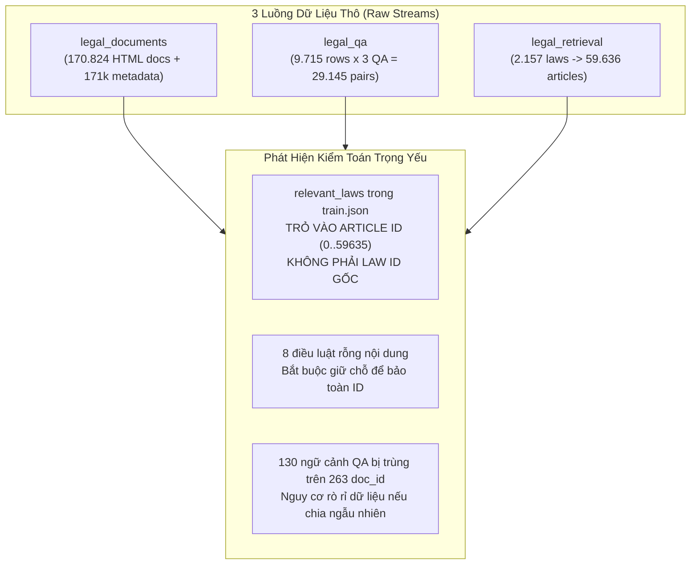

# Phase 1: Dataset Understanding & Exploratory Data Analysis (EDA)

## 1. Nhiệm vụ cốt lõi (Làm gì?)
Khảo sát, giải mã cấu trúc và kiểm toán tính toàn vẹn của 3 luồng dữ liệu pháp lý thô trước khi xây dựng pipeline tiền xử lý và lập chỉ mục:
* **Mục tiêu:** Xác định cấu trúc trường, phân bố số lượng, phát hiện rác định dạng (HTML, CSS), kiểm tra tính liên kết khóa chéo (cross-dataset linkability), và phát hiện nguy cơ rò rỉ dữ liệu (data leakage).
* **Đầu vào (Raw Inputs):**
  * `data/raw/legal_documents/`: 170.824 văn bản HTML (12 shards), 171.556 bản ghi metadata, 1.033.255 cạnh quan hệ trích dẫn (`relationships`).
  * `data/raw/legal_qa/vietnamese_legal_qa.parquet`: 9.715 ngữ cảnh điều luật kèm mảng câu hỏi-đáp lồng nhau.
  * `data/raw/legal_retrieval/`: `legal_corpus.json` (2.157 văn bản chứa 59.636 điều luật), `train.json` (2.190 truy vấn có nhãn).
* **Đầu ra (Outputs):** Báo cáo kiểm toán dữ liệu và tập ràng buộc kỹ thuật bất biến làm tiền đề cho Phase 2, Phase 3, Phase 4.

---

## 2. Kiến trúc & Phân tích Quan hệ Dữ liệu (Data Flow & Entity Relations)

### Các phát hiện kiểm toán mang tính quyết định:
1. **Định danh truy xuất (`global_article_id`):** Trường `relevant_laws` trong `train.json` mang giá trị số nguyên thuộc dải $[0, 59635]$. Dù có tên là `laws`, thực chất đây là chỉ mục cấp **Điều luật (Article)** được làm phẳng theo thứ tự xuất hiện trong `legal_corpus.json`. Do đó, đơn vị truy xuất (retrieval unit) bắt buộc phải là từng Điều luật.
2. **Bảo tồn dải định danh (Corpus Stability):** Có đúng 8 điều luật bị rỗng nội dung hoặc chỉ chứa khoảng trắng. Tuyệt đối không được xóa bỏ 8 bản ghi này, vì việc xóa sẽ làm dịch chuyển toàn bộ `global_article_id` của 59.636 điều luật, làm sai lệch toàn bộ tập nhãn ground-truth.
3. **Hiện tượng trùng ngữ cảnh trong QA:** 130 văn bản điều luật được tái sử dụng trên 263 `doc_id` khác nhau (các điều luật mẫu, quy định chuyển tiếp). Nếu chia dữ liệu ngẫu nhiên theo `doc_id`, cùng một nội dung luật sẽ xuất hiện ở cả tập Train và Test $\rightarrow$ Gây rò rỉ dữ liệu (data leakage) nghiêm trọng.

---

## 3. Hiện thực Code (Dùng gì & Ở đâu?)

* **Mã nguồn thực thi:**
  * `scripts/archive/dataset_understanding.py`: Bóc tách cấu trúc parquet, đếm bản ghi, kiểm tra schema.
  * `scripts/archive/profile_corpus_text.py`: Đếm phân phối độ dài từ, ký tự, phát hiện 8 điều luật rỗng.
  * `scripts/archive/validate_corpus_ids.py`: Kiểm định tính duy nhất của ID văn bản và thứ tự mảng điều luật.
* **Thư viện sử dụng:** `pandas`, `pyarrow`, `json`, `collections.Counter`.
* **Cấu trúc trường dữ liệu thô:**
  * `legal_documents/content`: `id` (str), `content_html` (str chứa thẻ HTML, CSS `<style>` và bảng `<table>`).
  * `legal_documents/metadata`: 17 trường quản lý hành chính (`so_ky_hieu`, `loai_van_ban`, `ngay_ban_hanh`,...).
  * `legal_qa`: `doc_name`, `article_content`, `generated_qa_pairs` (list 3 dicts: `question`, `answer`, `difficulty`, `question_type`).
  * `legal_retrieval/legal_corpus.json`: Mảng phân cấp `{"id": int, "law_id": str, "content": [{"aid": int, "content_Article": str}]}`.

---

## 4. Kết luận & Quyết định Kỹ thuật (Takeaways)

| Hiện tượng thực tế | Rủi ro nếu không xử lý | Quyết định kỹ thuật áp dụng |
|---|---|---|
| 8 điều luật rỗng trong `legal_corpus.json` | Dịch chuyển toàn bộ dải index $[0, 59635]$, làm sai lệch nhãn Ground Truth | Giữ nguyên 8 bản ghi, gắn cờ `is_empty_preprocessed = True` |
| Rác HTML & CSS trong `legal_documents` | Trộn lẫn cú pháp stylesheet và thẻ DOM vào text sinh vector | Bóc tách text bằng BeautifulSoup, loại bỏ triệt để `<style>`, `<script>` |
| 130 ngữ cảnh QA bị trùng lặp | Mô hình LLM/RAG học vẹt ngữ cảnh từ Train sang Test | Bắt buộc gom cụm phân chia theo mã băm ngữ cảnh `md5(context)` tại Phase 4 |
| Bảng mã Unicode không đồng nhất | Tokenizer và thuật toán so khớp từ khóa bị lệch mã (NFC vs NFD) | Ép chuẩn hóa bắt buộc `unicodedata.normalize('NFC')` toàn hệ thống |
