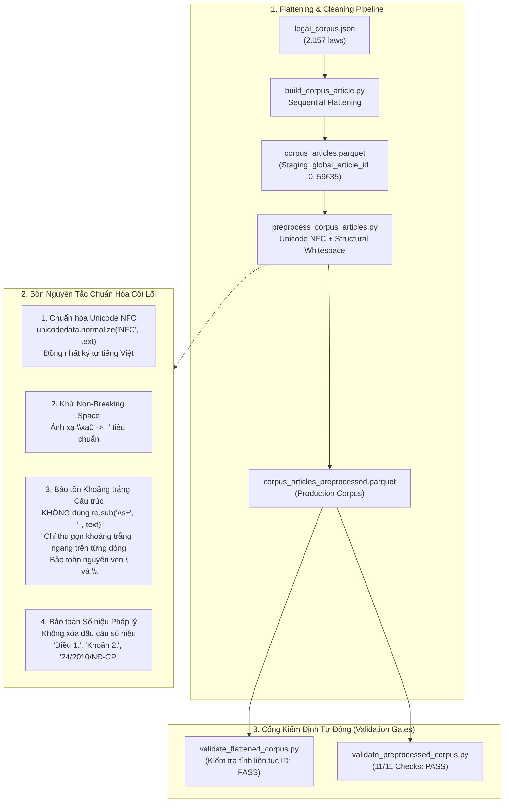

# Phase 2 & 3: Data Preprocessing & Corpus Flattening

## 1. Nhiệm vụ cốt lõi (Làm gì?)
Biến đổi dữ liệu thô dạng phân cấp, chứa rác định dạng và phân mảnh bảng mã thành các bảng Parquet phẳng, chuẩn hóa cơ học và làm sạch ngữ nghĩa:
* **Làm phẳng Corpus (Corpus Flattening):** Phẳng hóa 2.157 văn bản luật phân cấp trong `legal_corpus.json` thành bảng 59.636 điều luật độc lập, gán `global_article_id` liên tục từ `0` đến `59635`.
* **Làm sạch & Chuẩn hóa Text:** Loại bỏ rác HTML/CSS, chuẩn hóa mã hóa Unicode NFC toàn diện, khử ký tự điều khiển/NBSP, bảo toàn cấu trúc ngắt dòng và số hiệu pháp lý.
* **Chuẩn hóa nhãn QA:** Phẳng hóa 9.715 bản ghi QA thành 29.145 cặp độc lập, quy chuẩn từ điển phân loại độ khó và loại câu hỏi.
* **Đầu ra (Production Outputs):**
  * `data/processed/legal_retrieval/corpus_articles_preprocessed.parquet` (59.636 hàng).
  * `data/processed/legal_qa/legal_qa_preprocessed.parquet` (29.145 hàng).
  * `data/processed/legal_documents/legal_documents_preprocessed.parquet` (170.824 văn bản).

---

## 2. Kiến trúc & Luồng xử lý (Architecture & Data Flow)



---

## 3. Hiện thực Code (Dùng gì & Ở đâu?)

### A. Danh mục Scripts & Modules
| Tác vụ | File Script | Thư viện chính | Đầu ra Artifact |
|---|---|---|---|
| Làm phẳng Corpus | `scripts/processing/build_corpus_article.py` | `json`, `pyarrow`, `pandas` | `data/processed/legal_retrieval/corpus_articles.parquet` |
| Tiền xử lý Corpus | `scripts/processing/preprocess_corpus_articles.py` | `unicodedata`, `re`, `pyarrow` | `data/processed/legal_retrieval/corpus_articles_preprocessed.parquet` |
| Tiền xử lý QA | `scripts/processing/preprocess_legal_qa.py` | `pyarrow`, `pandas` | `data/processed/legal_qa/legal_qa_preprocessed.parquet` |
| Tiền xử lý Document | `scripts/processing/preprocess_legal_documents.py` | `beautifulsoup4`, `unicodedata` | `data/processed/legal_documents/legal_documents_preprocessed.parquet` |

### B. Schema Chuẩn của Production Corpus (`corpus_articles_preprocessed.parquet`)
* `global_article_id` (`int64`): Khóa chính hệ thống, chạy liên tục $[0, 59635]$.
* `doc_id` (`int64`): ID văn bản luật gốc.
* `law_id` (`string`): Số hiệu văn bản (vd: `14/2022/TT-NHNN`).
* `aid` (`int64`): ID điều luật nội bộ của văn bản đó.
* `text` / `text_preprocessed` (`string`): Nội dung điều luật đã làm sạch chuẩn NFC.
* `text_raw` (`string`): Nội dung nguyên bản chưa qua xử lý.
* `char_count_preprocessed` (`int64`): Số ký tự sau làm sạch.
* `word_count_preprocessed` (`int64`): Số từ sau làm sạch.
* `is_empty_preprocessed` (`bool`): Cờ đánh dấu văn bản rỗng (có đúng 8 bản ghi `True`).

### C. Logic xử lý khoảng trắng chuẩn mực (Trích đoạn code cốt lõi)
```python
def normalize_text(text: str) -> str:
    if not text:
        return ""
    # 1. Chuẩn hóa bảng mã Unicode NFC
    text = unicodedata.normalize("NFC", text)
    # 2. Thay thế non-breaking space
    text = text.replace("\xa0", " ")
    # 3. Chuẩn hóa ngắt dòng về Unix style
    text = text.replace("\r\n", "\n").replace("\r", "\n")
    # 4. Thu gọn khoảng trắng ngang trên từng dòng (BẢO TOÀN \n và \t)
    lines = [re.sub(r"[^\S\r\n\t]+", " ", line).strip() for line in text.split("\n")]
    return "\n".join(lines).strip()
```

---

## 4. Kết quả & Đánh giá (Metrics & Takeaways)

### Kết quả kiểm định tự động (Validation Gates):
Toàn bộ script kiểm định trả về `exit code 0` kèm báo cáo văn bản:
1. **Corpus Articles Preprocessed (`validate_preprocessed_corpus.py`):**
   * Tổng số điều luật: Đúng chuẩn **59.636 bản ghi**.
   * Dải ID: Liên tục không đứt gãy từ `0` đến `59.635`.
   * Cờ rỗng: Đúng **8 bản ghi** có `is_empty_preprocessed = True` (chiếm 0.013%).
   * Không có bất kỳ lỗi phân mảnh Unicode NFD hay ký tự `\xa0` nào tồn dư.
2. **Legal QA Preprocessed (`validate_legal_qa.py`):**
   * Tổng số cặp QA: Đúng chuẩn **29.145 cặp** phẳng.
   * Taxonomy chuẩn hóa thành công về 3 mức độ khó (`easy`, `medium`, `hard`) và 4 dạng câu hỏi (`factual`, `application`, `interpretation`, `analytical`).
3. **Legal Documents (`validate_legal_documents.py`):**
   * 170.824 văn bản bóc tách sạch toàn bộ HTML DOM và CSS stylesheet, tỷ lệ null nội dung 0.0%.
