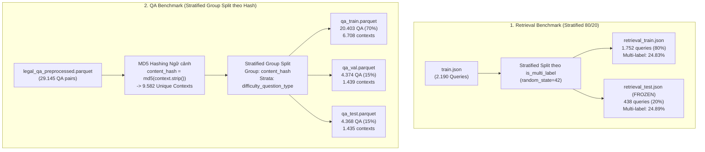

# Phase 4: Benchmark Split Construction & Evaluation Design

## 1. Nhiệm vụ cốt lõi (Làm gì?)
Xây dựng hai bộ dữ liệu đánh giá chuẩn mực (Ground-Truth Benchmarks) phục vụ thẩm định chất lượng các mô hình: **Retrieval Benchmark** (cho bộ truy xuất) và **QA Benchmark** (cho hệ thống sinh RAG):
* **Mục tiêu:** Đảm bảo tính khách quan tuyệt đối trong đo lường, bảo toàn phân bố dữ liệu (Stratification) và triệt tiêu hoàn toàn hiện tượng rò rỉ dữ liệu giữa các tập (Mathematical Zero Leakage).
* **Đầu vào (Inputs):**
  * `train.json`: 2.190 câu truy vấn thực tế có gán nhãn điều luật liên quan.
  * `legal_qa_preprocessed.parquet`: 29.145 cặp câu hỏi-đáp pháp lý đã tiền xử lý.
* **Đầu ra (Frozen Benchmark Artifacts):**
  * `data/benchmarks/retrieval_train.json` (1.752 queries) & `data/benchmarks/retrieval_test.json` (438 queries).
  * `data/benchmarks/qa_train.parquet` (20.403 QA), `qa_val.parquet` (4.374 QA), `qa_test.parquet` (4.368 QA).

---

## 2. Kiến trúc & Phương pháp luận Phân chia (Splitting Methodology)

### Chi tiết kỹ thuật chống rò rỉ dữ liệu:
1. **Retrieval Split (Bảo toàn tỷ lệ Đơn nhãn / Đa nhãn):**
   * Trong 2.190 queries, có 75.1% là truy vấn đơn nhãn (chỉ cần 1 điều luật) và 24.9% là truy vấn đa nhãn (cần 2 đến 9 điều luật).
   * Phân tầng theo thuộc tính `is_multi_label` đảm bảo tỷ lệ đa nhãn ở tập Test (24.89%) tương đồng chính xác với tập Train (24.83%), tránh làm sai lệch các chỉ số xếp hạng nhạy cảm với số lượng nhãn như MAP và nDCG.
2. **QA Split (Zero Context Leakage qua MD5 Grouping):**
   * Khảo sát phát hiện 130 nội dung điều luật bị trùng lặp trên 263 `doc_id` khác nhau.
   * Nếu chỉ group theo `doc_id`, mô hình sẽ gặp câu hỏi ở tập Test nhưng có ngữ cảnh đã thấy ở tập Train $\rightarrow$ Gây rò rỉ ngữ cảnh (Data Leakage).
   * **Giải pháp:** Grouping theo `content_hash = md5(context.strip())`. Đảm bảo tập giao ngữ cảnh bằng rỗng:
     $$\text{Contexts}_{\text{train}} \cap \text{Contexts}_{\text{val}} = \emptyset, \quad \text{Contexts}_{\text{train}} \cap \text{Contexts}_{\text{test}} = \emptyset$$

---

## 3. Hiện thực Code (Dùng gì & Ở đâu?)

### A. Danh mục Scripts & Modules
| Phân hệ | File Script | Thư viện chính | Đầu ra Artifact |
|---|---|---|---|
| Xây dựng Retrieval Benchmark | `scripts/benchmarks/build_retrieval_benchmark.py` | `scikit-learn`, `json` | `data/benchmarks/retrieval_{train,test}.json` |
| Xây dựng QA Benchmark | `scripts/benchmarks/build_qa_benchmark.py` | `scikit-learn`, `hashlib`, `pandas` | `data/benchmarks/qa_{train,val,test}.parquet` |
| Kiểm định Retrieval Benchmark | `scripts/validation/validate_retrieval_benchmark.py` | `json`, `sys` | Báo cáo kiểm định toàn vẹn ID |
| Kiểm định QA Benchmark | `scripts/validation/validate_qa_benchmark.py` | `pyarrow`, `pandas` | Báo cáo kiểm định Zero Leakage |

### B. Hợp đồng dữ liệu chuẩn (Data Contract)
* **Retrieval JSON:**
  * `query_id` (`int`): Mã truy vấn duy nhất.
  * `query_text` (`string`): Câu hỏi người dùng đã chuẩn hóa NFC.
  * `relevant_article_ids` (`list[int]`): Danh sách `global_article_id` liên quan đã sắp xếp tăng dần, thuộc dải $[0, 59635]$.
* **QA Parquet:**
  * `qa_id` (`int64`), `doc_id` (`int64`), `content_hash` (`string` 32 ký tự hex MD5).
  * `question`, `answer`, `context` (`string` chuẩn NFC).
  * `difficulty` (`easy`, `medium`, `hard`).
  * `question_type` (`factual`, `application`, `interpretation`, `analytical`).

---

## 4. Kết quả & Đánh giá (Metrics & Takeaways)

### A. Phân phối cân bằng hoàn hảo trên các tập QA
Nhờ cơ chế phân tầng đa biến `strata = difficulty + "_" + question_type`, phân phối câu hỏi giữa Train, Val và Test đạt độ đồng nhất gần như tuyệt đối:
* **Độ khó (`difficulty`):**
  * `easy`: Toàn bộ 33.36% $\rightarrow$ Train 33.36% | Val 33.42% | Test 33.31%.
  * `medium`: Toàn bộ 33.35% $\rightarrow$ Train 33.35% | Val 33.31% | Test 33.38%.
  * `hard`: Toàn bộ 33.29% $\rightarrow$ Train 33.29% | Val 33.26% | Test 33.31%.
* **Dạng câu hỏi (`question_type`):**
  * `factual`: ~33.4% ở tất cả các tập.
  * `application`: ~25.8% ở tất cả các tập.
  * `interpretation`: ~22.1% ở tất cả các tập.
  * `analytical`: ~18.6% ở tất cả các tập.

### B. Quy ước thực nghiệm bất biến (Experimental Rules)
1. **Frozen Test Set:** Tập 438 queries trong `retrieval_test.json` được đóng băng hoàn toàn. Mọi thuật toán từ Phase 5 (BM25, TF-IDF), Phase 6 (Dense Bi-Encoder), Phase 11 (Hybrid RRF) đến Phase 12 (Cross-Encoder) đều phải đánh giá trên cùng tập 438 queries này.
2. **Không dò siêu tham số trên Test Set:** Mọi quá trình tinh chỉnh (tuning grid $k_1, b$, trọng số $w_{\text{dense}}$) bắt buộc chỉ được thực hiện trên tập `retrieval_train.json` (1.752 queries).
