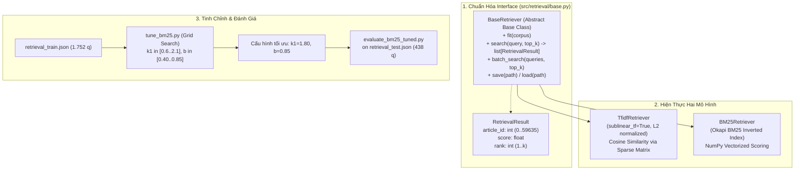

# Phase 5: Lexical Search Baselines (TF-IDF & Okapi BM25)

## 1. Nhiệm vụ cốt lõi (Làm gì?)
Xây dựng nền tảng truy xuất từ khóa truyền thống (Lexical Baselines) làm thước đo đối chuẩn (benchmark baselines) cho toàn bộ dự án:
* **Chuẩn hóa khung kiến trúc:** Thiết kế Interface trừu tượng `BaseRetriever` và bộ đo lường tiêu chuẩn Information Retrieval (IR metrics).
* **Triển khai hai thuật toán từ khóa:**
  * **Baseline 1A (TF-IDF):** Sparse vectorization với độ đo tương đồng Cosine.
  * **Baseline 1B (Okapi BM25):** Inverted index với bão hòa tần suất từ (Term Frequency Saturation) và phạt độ dài văn bản (Length Normalization).
* **Đầu vào:** `corpus_articles_preprocessed.parquet` (59.636 điều luật), `retrieval_train.json` (1.752 queries), `retrieval_test.json` (438 queries).
* **Đầu ra:** Chỉ mục `tfidf_index.joblib` (48.31 MB), `bm25_index.pkl` (48.25 MB) và báo cáo thực nghiệm chi tiết.

---

## 2. Kiến trúc & Luồng xử lý (Architecture & Data Flow)



### Cơ chế toán học của BM25 so với TF-IDF:
Điểm số BM25 của tài liệu $D$ với truy vấn $Q$ chứa các từ $q_i$:
$$\text{Score}(D, Q) = \sum_{q_i \in Q} \text{IDF}(q_i) \cdot \frac{f(q_i, D) \cdot (k_1 + 1)}{f(q_i, D) + k_1 \cdot \left(1 - b + b \cdot \frac{|D|}{\text{avgdl}}\right)}$$
* $k_1 = 1.80$: Điều tiết mức độ bão hòa tần suất từ. Khắc phục nhược điểm của TF-IDF (vốn tính điểm tăng tuyến tính hoặc log vô hạn khi một từ khóa xuất hiện quá nhiều lần trong một điều luật dài).
* $b = 0.85$: Phạt độ dài tài liệu mạnh hơn mặc định ($0.75$). Giúp các điều luật ngắn, trúng đích trực diện không bị thua thiệt điểm số so với các điều luật đồ sộ chứa hàng chục khoản.

---

## 3. Hiện thực Code (Dùng gì & Ở đâu?)

### A. Danh mục Modules & Scripts
| Thành phần | Đường dẫn File | Công nghệ / Thư viện | Vai trò |
|---|---|---|---|
| Retriever Interface | `src/retrieval/base.py` | `dataclasses`, `abc` | Định nghĩa `BaseRetriever` và `RetrievalResult` |
| TF-IDF Implementation | `src/retrieval/tfidf_retriever.py` | `scikit-learn`, `scipy.sparse`, `joblib` | Khởi tạo vectorizer unigram, sparse matmul |
| BM25 Implementation | `src/retrieval/bm25_retriever.py` | `numpy`, `pickle`, `re` | Xây dựng Inverted Index, vector hóa chấm điểm BM25 |
| Bộ tính Metrics | `src/evaluation/retrieval_metrics.py` | `numpy` | Đo P@k, R@k, MRR@10, MAP@10, nDCG@10, nDCG@100 |
| Xây dựng chỉ mục | `scripts/retrieval/build_bm25_index.py`<br>`scripts/retrieval/build_tfidf_index.py` | `pandas`, `pathlib` | Lập chỉ mục trên 59.636 điều luật |
| Tinh chỉnh tham số | `scripts/retrieval/tune_bm25.py` | `numpy` | Quét lưới 30 cấu hình trên tập Train |
| Đánh giá & phân tích | `scripts/evaluation/evaluate_bm25_tuned.py`<br>`scripts/evaluation/analyze_keyword_winloss.py` | `json` | Đo metric trên Test set, phân tích Win/Loss |

### B. Trích đoạn API sử dụng chuẩn
```python
from src.retrieval.bm25_retriever import BM25Retriever

# 1. Nạp chỉ mục đã huấn luyện
retriever = BM25Retriever.load("data/indices/bm25_index.pkl")
retriever.set_params(k1=1.80, b=0.85)  # Áp dụng tham số tối ưu

# 2. Truy vấn top-k điều luật
results = retriever.search("Thời hiệu khởi kiện tranh chấp hợp đồng lao động", top_k=10)
for r in results:
    print(f"Hạng {r.rank}: Article ID {r.article_id} - Điểm: {r.score:.4f}")
```

---

## 4. Kết quả & Đánh giá (Metrics & Takeaways)

### A. Bảng đối chuẩn thực nghiệm trên Frozen Test Set (438 Queries)

| Chỉ số đánh giá | TF-IDF (Baseline 1A) | BM25 Default ($k_1=1.5, b=0.75$) | BM25 Tuned ($k_1=1.8, b=0.85$) | Cải thiện của Tuned vs TF-IDF |
|---|:---:|:---:|:---:|:---:|
| **Thời gian đáp ứng (Latency)** | 20.22 ms | 6.57 ms | **3.26 ms** | **Nhanh hơn 6.2 lần** |
| **Băng thông (Throughput)** | 49.26 QPS | 148.68 QPS | **301.09 QPS** | **+511.1%** |
| **Recall@1 (R@1)** | 0.1403 | 0.2771 | **0.2846** | **+102.8%** |
| **Recall@10 (R@10)** | 0.4781 | 0.6601 | **0.6671** | **+39.53%** |
| **Recall@100 (R@100)** | 0.8261 | 0.8537 | **0.8727** | **+5.64%** |
| **MRR@10** | 0.2700 | 0.4539 | **0.4610** | **+70.74%** |
| **nDCG@10** | 0.3039 | 0.4799 | **0.4866** | **+60.12%** |
| **MAP@10** | 0.2373 | 0.4049 | **0.4114** | **+73.37%** |

### B. Phân tích Thất bại & Giới hạn vật lý của Keyword Search
1. **Ưu thế tuyệt đối của BM25 Tuned:** So với TF-IDF, BM25 Tuned thắng thế vượt trội:
   * Tỷ lệ thắng (Win rate theo nDCG@10): **50.68% Wins**, 37.67% Ties, chỉ 11.64% Losses.
   * R@10 trên nhóm câu hỏi đơn nhãn đạt tới **72.34%** (so với 52.89% của TF-IDF).
2. **Hạn chế vật lý cốt lõi (Hard Failure Gate):**
   * Trong 438 test queries, có chính xác **99 queries (22.60%)** mà cả TF-IDF lẫn BM25 đều hoàn toàn không thể tìm thấy điều luật đúng trong Top 10 ($R@10 = 0.0$).
   * *Bản chất kỹ thuật:* Hố sâu từ vựng (**Vocabulary Mismatch** / Paraphrase). Người dân hỏi bằng ngôn ngữ tự nhiên đời thường (ví dụ: *"bị chồng đánh đập đuổi ra khỏi nhà"*), trong khi văn bản pháp luật sử dụng thuật ngữ hành chính quy chuẩn (*"bạo lực gia đình"*, *"xâm phạm quyền cư trú"*).
   * $\rightarrow$ **Kết luận kiến trúc:** Đây là giới hạn toán học không thể vượt qua của biểu diễn sparse từ khóa, đặt ra yêu cầu bắt buộc phải chuyển sang **Dense Semantic Retrieval (Phase 6)** với mô hình ngôn ngữ ngữ nghĩa đa tầng.
