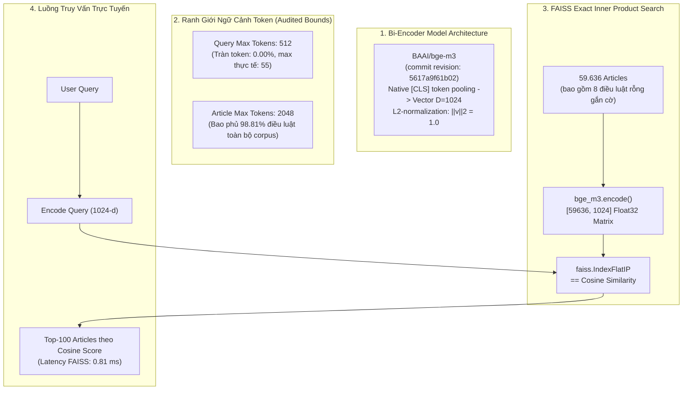

# Phase 6: Dense Bi-Encoder Retrieval (BGE-M3)

## 1. Nhiệm vụ cốt lõi (Làm gì?)
Xây dựng mô hình biểu diễn ngữ nghĩa dạng vector dày đặc (Dense Semantic Retrieval) nhằm giải quyết triệt để rào cản "hố sâu từ vựng" (Vocabulary Mismatch) mà các phương pháp sparse từ khóa (TF-IDF, BM25) gặp phải:
* **Mục tiêu:** Ánh xạ câu truy vấn của người dùng và các điều luật vào cùng một không gian vector ngữ nghĩa $D = 1024$.
* **Đầu vào:** `corpus_articles_preprocessed.parquet` (59.636 điều luật), `retrieval_train.json` (1.752 queries), `retrieval_test.json` (438 queries).
* **Đầu ra:** Chỉ mục FAISS `IndexFlatIP` (Exact Inner Product Search) đạt 232.95 MB vector float32, và báo cáo đối chuẩn thực nghiệm chuyên sâu với BM25 Tuned.

---

## 2. Kiến trúc & Luồng xử lý (Architecture & Data Flow)



### Cơ sở toán học:
Mọi vector nhúng $\mathbf{u}$ (truy vấn) và $\mathbf{v}$ (điều luật) đều được chuẩn hóa $L_2$ ngay sau khi trích xuất:
$$\hat{\mathbf{v}} = \frac{\mathbf{v}}{\|\mathbf{v}\|_2}$$
Do đó, phép nhân vô hướng Inner Product trong FAISS `IndexFlatIP` đồng nhất tuyệt đối với độ đo Cosine Similarity:
$$\langle \hat{\mathbf{u}}, \hat{\mathbf{v}} \rangle = \cos(\theta) = \frac{\mathbf{u} \cdot \mathbf{v}}{\|\mathbf{u}\|_2 \|\mathbf{v}\|_2}$$

---

## 3. Hiện thực Code (Dùng gì & Ở đâu?)

### A. Danh mục Modules & Scripts
| Phân hệ | Đường dẫn File | Công nghệ / Mô hình | Vai trò |
|---|---|---|---|
| Dense Encoder Module | `src/retrieval/dense/encoder.py` | `FlagEmbedding`, `PyTorch` | Nạp weights `BAAI/bge-m3`, sinh vector CLS normalized |
| Dense Index Module | `src/retrieval/dense/index.py` | `faiss-cpu` / `faiss-gpu` | Quản lý `IndexFlatIP`, lưu trữ và nạp chỉ mục vector |
| Dense Retriever Class | `src/retrieval/dense/retriever.py` | `src.retrieval.base.BaseRetriever` | Lớp bọc kế thừa chuẩn, thực thi `search(query, top_k)` |
| Xây dựng chỉ mục | `scripts/retrieval/build_dense_index.py` | `torch.cuda`, `tqdm` | Sinh embedding cho 59.636 điều luật (batch_size=32) |
| Đánh giá & đối chuẩn | `scripts/evaluation/evaluate_dense.py`<br>`scripts/evaluation/analyze_dense_vs_bm25.py` | `json`, `numpy` | Đánh giá độc lập trên Frozen Test Set (438 queries) |

### B. Trích đoạn API sử dụng chuẩn
```python
from src.retrieval.dense.retriever import DenseRetriever

# Khởi tạo và nạp chỉ mục BGE-M3 FAISS
retriever = DenseRetriever.load(
    index_path="data/indices/dense_index_bge_m3.faiss",
    model_name_or_path="BAAI/bge-m3",
    max_query_length=512,
    device="cuda"  # hoặc "cpu"
)

# Tìm kiếm ngữ nghĩa top-10 điều luật
results = retriever.search("Người lao động bị sa thải trái pháp luật được bồi thường gì?", top_k=10)
```

---

## 4. Kết quả & Đánh giá (Metrics & Takeaways)

### A. Bảng đối chuẩn thực nghiệm: BM25 Tuned vs. Dense BGE-M3 (438 Test Queries)

| Chỉ số đánh giá | BM25 Tuned ($k_1=1.8, b=0.85$) | Dense BGE-M3 (Zero-shot) | Chênh lệch Tuyệt đối | Tỷ lệ Cải thiện (%) |
|---|:---:|:---:|:---:|:---:|
| **Thời gian truy vấn (Latency)** | **3.57 ms** | 19.10 ms (GPU MX350) / 0.81 ms (FAISS CPU) | — | Chấp nhận được trong RAG |
| **Thông lượng (Throughput)** | **280.11 QPS** | 52.37 QPS | — | — |
| **Precision@1 (P@1)** | 0.3288 | **0.4863** | +0.1575 | **+47.90%** |
| **Recall@1 (R@1)** | 0.2846 | **0.4176** | +0.1330 | **+46.73%** |
| **Recall@5 (R@5)** | 0.5644 | **0.7018** | +0.1374 | **+24.35%** |
| **Recall@10 (R@10)** | 0.6671 | **0.7969** | +0.1298 | **+19.46%** |
| **Recall@100 (R@100)** | 0.8727 | **0.9441** | +0.0714 | **+8.18%** |
| **MRR@10** | 0.4610 | **0.6146** | +0.1536 | **+33.33%** |
| **MAP@10** | 0.4114 | **0.5520** | +0.1406 | **+34.18%** |
| **nDCG@10** | 0.4866 | **0.6277** | +0.1411 | **+29.00%** |

### B. Khả năng giải cứu các ca thất bại nặng nề của BM25 (Hard Rescue Analysis)
* Trong 438 test queries, BM25 có **112 câu hỏi thất bại hoàn toàn tại Top-10** ($R@10 = 0$).
* Mô hình Dense BGE-M3 đã **giải cứu thành công 67 câu hỏi** trong số 112 câu này (**Tỷ lệ giải cứu thành công đạt 59.82%**).
* Trong 67 ca được giải cứu, có tới **26 câu hỏi (38.81%)** được mô hình Dense đưa thẳng lên vị trí **Rank 1**.
* **Nhược điểm tồn đọng:** Vẫn có 12 câu hỏi BM25 tìm đúng nhưng Dense lại bỏ lỡ (thường là các câu hỏi chứa chính xác số hiệu văn bản luật chuyên ngành hoặc từ viết tắt hiếm) $\rightarrow$ Đặt tiền đề cho phương pháp **Hybrid Fusion kết hợp BM25 + Dense (Phase 11)**.
