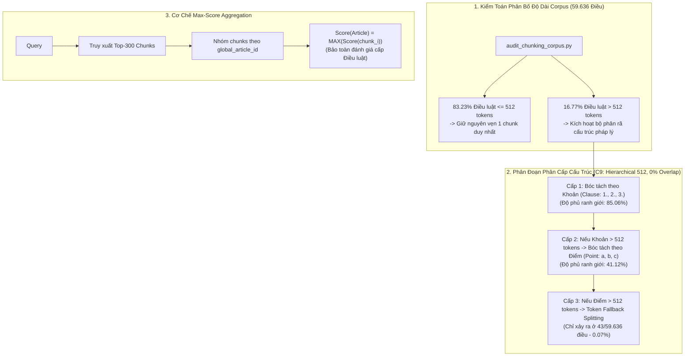

# Phase 7: Legal Document Chunking Strategy

## 1. Nhiệm vụ cốt lõi (Làm gì?)
Nghiên cứu và thiết lập chiến lược phân đoạn văn bản pháp luật tối ưu:
* **Mục tiêu:** Chia nhỏ các điều luật đồ sộ thành các đơn vị phân đoạn (chunks) vừa vặn ngân sách token của mô hình ngôn ngữ mà không phá vỡ tính liên kết ngữ nghĩa pháp lý, nâng cao độ sắc nét khi sinh embedding.
* **Đầu vào:** `corpus_articles_preprocessed.parquet` (59.636 điều luật), tokenizer của `BAAI/bge-m3`.
* **Đầu ra:** Tập dữ liệu phân đoạn chính thức `corpus_chunks_struct_hier_512_o0_v1.parquet` gồm **79.977 chunks**, tích hợp cơ chế tổng hợp điểm số cực đại (**Max-score Aggregation**) để bảo toàn đơn vị đánh giá cấp Điều luật (`global_article_id`).

---

## 2. Kiến trúc & Luồng xử lý (Architecture & Data Flow)

### Tại sao chọn Phân cấp Cấu trúc (Structure-Aware) thay vì Cửa sổ trượt (Fixed Window)?
* Trong văn bản pháp quy Việt Nam, các Khoản và Điểm là các mệnh đề pháp lý khép kín mang tính chế tài hoặc điều kiện độc lập.
* Cắt cửa sổ trượt cơ học (fixed chunking) sẽ cắt ngang giữa chừng một quy định (ví dụ nửa trước của mức phạt nằm ở chunk 1, nửa sau nằm ở chunk 2), phá vỡ hoàn toàn ngữ cảnh logic.
* Chiến lược C9 bóc tách đúng ranh giới pháp lý tự nhiên, tạo ra lượng chunk tối ưu: chỉ **1.34 chunks/điều luật** (79.977 chunks), thấp hơn rất nhiều so với chiến lược cắt khoản cứng (114.497 chunks) mà đạt hiệu năng truy xuất vượt trội.

---

## 3. Hiện thực Code (Dùng gì & Ở đâu?)

### A. Danh mục Modules & Scripts
| Thành phần | Đường dẫn File | Công nghệ / Thuật toán | Vai trò |
|---|---|---|---|
| Parser Cấu trúc | `src/retrieval/chunking/parser.py` | Regex phân cấp tiếng Việt | Nhận diện tiêu đề Điều, số hiệu Khoản (`1.`, `2.`), Điểm (`a)`, `b)`) |
| Bộ phân đoạn phân cấp | `src/retrieval/chunking/hierarchical_chunker.py` | `transformers.AutoTokenizer` | Điều phối logic C9: Điều $\to$ Khoản $\to$ Điểm $\to$ Token |
| Cấu trúc dữ liệu Chunk | `src/retrieval/chunking/chunk_record.py` | Python `dataclass` | Định nghĩa schema cho từng chunk pháp lý |
| Sinh tệp Chunk toàn văn | `scripts/retrieval/build_chunks.py` | `pyarrow`, `pandas` | Sinh tệp Parquet 79.977 chunks hoàn chỉnh |
| So sánh ma trận chiến lược | `scripts/retrieval/compare_chunking_strategies.py` | `numpy` | Đối chuẩn 5 chiến lược trên tập Dev Validation (351 queries) |
| Đánh giá Test nghiệm thu | `scripts/retrieval/evaluate_chunking.py` | `json` | Đánh giá chính thức trên Frozen Test Set (438 queries) |

### B. Schema Chuẩn của tệp Chunks (`corpus_chunks_struct_hier_512_o0_v1.parquet`)
* `chunk_id` (`string`): Định danh duy nhất định dạng `{global_article_id}_c{chunk_index}`.
* `global_article_id` (`int64`): ID điều luật gốc (dải $[0, 59635]$).
* `doc_id` (`int64`), `law_id` (`string`), `aid` (`int64`): Siêu dữ liệu văn bản mẹ.
* `text` (`string`): Nội dung đoạn văn của chunk.
* `chunk_level` (`string`): Mức phân đoạn (`article`, `clause`, `point`, hoặc `token_fallback`).
* `char_count`, `word_count`, `token_count` (`int64`): Các độ đo độ dài.

---

## 4. Kết quả & Đánh giá (Metrics & Takeaways)

### A. Bảng nghiệm thu chính thức trên Frozen Hold-out Test (438 queries)

| Chỉ số đánh giá | Phase 6 (Điều luật nguyên vẹn) | Phase 7 (C9: Hierarchical 512) | Chênh lệch Tuyệt đối | Tỷ lệ Cải thiện (%) |
|---|:---:|:---:|:---:|:---:|
| **nDCG@10** | 0.6277 | **0.6356** | +0.0079 | **+1.26%** |
| **Recall@10** | 0.7969 | **0.8081** | +0.0112 | **+1.41%** |
| **Recall@5** | 0.7018 | **0.7189** | +0.0171 | **+2.44%** |
| **Recall@100** | 0.9441 | **0.9476** | +0.0035 | **+0.37%** |
| **MRR@10** | 0.6146 | **0.6177** | +0.0031 | +0.50% |
| **MAP@10** | 0.5520 | **0.5600** | +0.0080 | **+1.45%** |
| **Thời gian tìm vector FAISS** | 0.81 ms / query | **1.03 ms / query** | +0.22 ms | Vẫn duy trì tốc độ cực nhanh |
| **Kích thước ma trận vector** | 232.95 MB | **312.41 MB** | +79.46 MB | Nhẹ, dễ dàng phục vụ in-memory |

### B. Bài học kỹ thuật rút ra:
1. **Bảo tồn điều luật ngắn:** 83.23% điều luật ngắn không cần phân đoạn, giữ nguyên vẹn giúp duy trì bức tranh toàn cảnh của điều luật và tái sử dụng 100% embedding tính sẵn.
2. **Loại bỏ hiện tượng nhạt nhòa vector (Vector Dilution):** Đối với 16.77% điều luật dài, việc phân đoạn giúp vector của từng Khoản/Điểm tập trung cao độ vào bản chất hành vi pháp lý, nâng trực tiếp Recall@5 từ $70.18\% \to \mathbf{71.89\%}$.
3. **Cơ chế Max-pooling hiệu quả:** Trả về điểm số cao nhất của các chunk con lên cấp Điều luật giúp mô hình giữ vững tính tương thích với dải ID hệ thống mà không cần định nghĩa lại đơn vị ground-truth.
