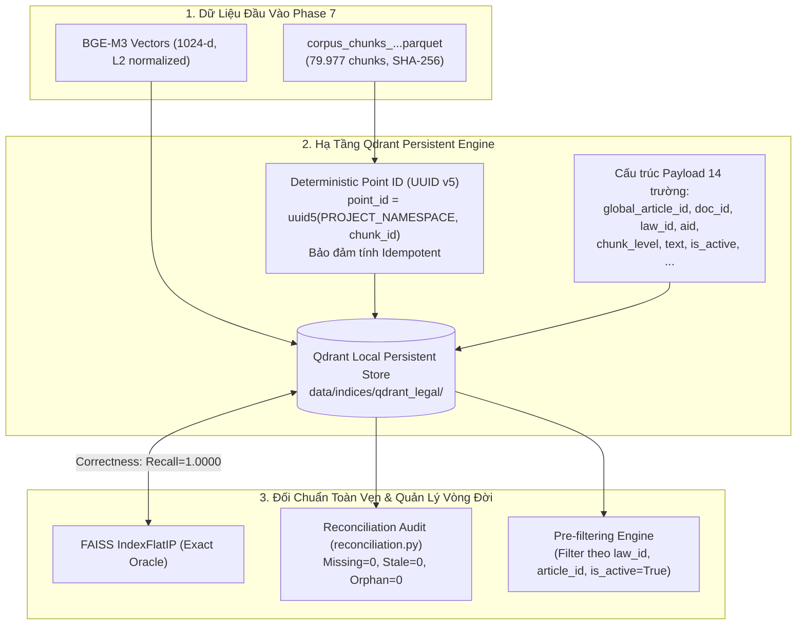

# Phase 8: Vector Database Indexing & Lifecycle Management

## 1. Nhiệm vụ cốt lõi (Làm gì?)
Xây dựng hạ tầng cơ sở dữ liệu vector chuyên dụng (Vector Database) bền vững cho môi trường sản xuất:
* **Mục tiêu:** Lưu trữ bền vững (persistent storage) 79.977 chunks vector từ Phase 7, hỗ trợ quản lý vòng đời dữ liệu (Idempotent Upsert, Soft/Hard Delete), lọc theo siêu dữ liệu trước truy vấn (Metadata Pre-filtering) và đối soát toàn vẹn (Reconciliation).
* **Đầu vào:** `corpus_chunks_struct_hier_512_o0_v1.parquet` (79.977 chunks) kèm vector BGE-M3 (1024-d).
* **Đầu ra:** Cơ sở dữ liệu vector Qdrant lưu trữ tại `data/indices/qdrant_legal/`, bộ kiểm toán đối soát không sai lệch, và lớp truy xuất `ChunkedVectorRetriever`.

---

## 2. Kiến trúc & Luồng xử lý (Architecture & Data Flow)



### Điểm nhấn kỹ thuật kiến trúc:
1. **Lựa chọn Qdrant Embedded/Local:** Sử dụng `QdrantClient(path="data/indices/qdrant_legal")` giúp hệ thống hoàn toàn độc lập, không phụ thuộc service bên ngoài trong giai đoạn nghiên cứu, sẵn sàng chuyển đổi sang Qdrant Server khi đóng gói Docker.
2. **Định danh tất định (Deterministic Point Identity):** Mọi bản ghi vector đều được gán `point_id` sinh bằng **UUID v5** từ chuỗi `chunk_id` kết hợp một Namespace cố định. Nhờ đó, việc nạp lại dữ liệu (re-run ingest) tuyệt đối không sinh ra bản ghi trùng lặp (Idempotent 100%).
3. **Lọc trước (Pre-filtering):** Tách biệt truy vấn theo từng văn bản luật hoặc điều khoản cụ thể bằng bộ lọc payload trước khi tính khoảng cách vector, giúp tiết kiệm tài nguyên tính toán.

---

## 3. Hiện thực Code (Dùng gì & Ở đâu?)

### A. Danh mục Modules & Scripts
| Phân hệ | Đường dẫn File | Công nghệ / Thư viện | Vai trò |
|---|---|---|---|
| Khởi tạo Qdrant Store | `src/retrieval/indexing/qdrant_store.py` | `qdrant-client` | Quản lý kết nối, cấu hình Collection, nạp vector & payload |
| Định danh Point ID | `src/retrieval/indexing/point_id.py` | `uuid.uuid5` | Sinh UUID v5 tất định từ `chunk_id` |
| Đối soát dữ liệu | `src/retrieval/indexing/reconciliation.py` | `pyarrow`, `qdrant-client` | Quét kiểm tra missing, stale, orphan vectors |
| Khôi phục & Rebuild | `src/retrieval/indexing/rebuild.py` | `qdrant-client` | Tái lập chỉ mục tự động khi có biến động dữ liệu |
| Retriever Tích hợp | `src/retrieval/chunked_retriever.py` | `BaseRetriever` | Lớp bọc tìm kiếm Top-K chunks và Max-score pooling |
| Script Ingestion | `scripts/indexing/ingest_chunks_to_qdrant.py` | `tqdm`, batch upsert | Nạp 79.977 chunks vào thư mục `data/indices/qdrant_legal` |

### B. Trích đoạn API sử dụng chuẩn
```python
from src.retrieval.indexing.qdrant_store import QdrantVectorStore

# 1. Khởi tạo kho vector ở chế độ cục bộ persistent
store = QdrantVectorStore(storage_path="data/indices/qdrant_legal", collection_name="vietnamese_legal_chunks")

# 2. Tìm kiếm ngữ nghĩa kết hợp lọc theo văn bản luật cụ thể
hits = store.search(
    query_vector=query_embedding,
    top_k=10,
    filters={"law_id": "14/2022/TT-NHNN", "is_active": True}
)
for hit in hits:
    print(f"Point ID: {hit.id} | Score: {hit.score:.4f} | Article: {hit.payload['global_article_id']}")
```

---

## 4. Kết quả & Đánh giá (Metrics & Takeaways)

### A. Kết quả kiểm toán đối chuẩn kỹ thuật (Audited Benchmarks)
Toàn bộ 12/12 yêu cầu kỹ thuật (FR-1 đến FR-12) đều đạt **PASS**:
* **Độ chính xác tuyệt đối so với Exact FAISS Oracle:**
  * **Recall@1 = 1.0000** (200/200 truy vấn ngẫu nhiên khớp Top-1 hoàn hảo).
  * **Recall@10 = 1.0000** (Top 10 trả về trùng khớp 100%).
  * **Mean Absolute Score Difference:** $< 10^{-6}$ (chỉ sai khác do làm tròn float32).
* **Kiểm toán Vòng đời (Lifecycle):**
  * Nạp lặp (Idempotent upsert): Số lượng vector không đổi khi nạp lại.
  * Cập nhật metadata: Thay đổi trường siêu dữ liệu có hiệu lực tức thì.
  * Xóa mềm (`is_active=False`) & Xóa cứng: Bộ lọc pre-filter loại trừ chuẩn xác 100%.
  * Độ bền dữ liệu (Persistence): Dữ liệu nguyên vẹn sau khi hủy tiến trình và restart.
* **Kiểm toán Đối soát (Reconciliation):**
  * Tổng chunks đối soát: **79.977**.
  * Missing vectors: **0** | Stale vectors: **0** | Orphan vectors: **0**.
* **Hiệu năng phục vụ (Performance):**
  * Thông lượng nạp: **250.9 vectors / giây**.
  * Độ trễ truy vấn: **p50 = 35.45 ms**, **p95 = 48.69 ms**.
  * Thông lượng phục vụ thực tế: **26.9 QPS** (trên máy trạm local).
