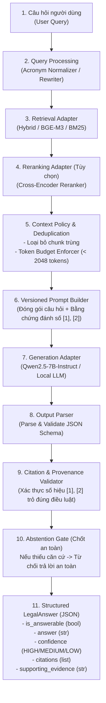

# Phase 9: Modular RAG Code Architecture & Enterprise Design

## 1. Nhiệm vụ cốt lõi (Làm gì?)
Thiết kế và hiện thực hóa kiến trúc phần mềm RAG (Retrieval-Augmented Generation) cấp doanh nghiệp (Enterprise-Grade) theo nguyên lý phân tách trách nhiệm (Separation of Concerns):
* **Mục tiêu:** Chuyển đổi năng lực truy xuất dữ liệu độc lập thành một hệ thống hỏi đáp pháp lý tự động hoàn chỉnh, có kiểm chứng căn cứ (Evidence-based), kiểm định trích dẫn (Citation Validation) và cơ chế từ chối trả lời an toàn (Abstention Gate).
* **Đầu vào:** Câu hỏi của người dùng, kho vector/chỉ mục văn bản luật.
* **Đầu ra:** Câu trả lời cấu trúc chuẩn `LegalAnswer` (JSON Pydantic) kèm trích dẫn pháp lý được kiểm định nguồn gốc (Provenance-verified).

---

## 2. Kiến trúc & Vòng đời Xử lý RAG Pipeline (Data Flow & Architecture)



---

## 3. Hiện thực Code (Dùng gì & Ở đâu?)

Toàn bộ mã nguồn cốt lõi được tổ chức dạng mô-đun hóa cao độ trong thư mục [`src/rag/`](file:///d:/PROJECT/PROJECT%202/src/rag/):

### A. Bản đồ các Gói chức năng (Package Structure)
| Package | Đường dẫn mã nguồn | Trách nhiệm cốt lõi |
|---|---|---|
| **Pipeline** | `src/rag/pipeline/` | Orchestrator điều phối toàn bộ luồng xử lý từ Query đến Answer |
| **Retrieval** | `src/rag/retrieval/` | Adapters chuẩn hóa giao thức giữa Pipeline và các Retrievers |
| **Reranking** | `src/rag/reranking/` | Adapters cho các mô hình Cross-Encoder định hạng lại Top-K |
| **Context** | `src/rag/context/` | Quản lý ngân sách token, khử trùng lặp (dedup), format context |
| **Prompting** | `src/rag/prompting/` | Quản lý template prompt có phiên bản (v1, v2) phục vụ thí nghiệm |
| **Generation** | `src/rag/generation/` | Adapter giao tiếp LLM (`Qwen2.5-7B-Instruct`, MockLLM cho CI/CD) |
| **Output** | `src/rag/output/` | Parser và schema Pydantic `LegalAnswer`, chống tràn JSON |
| **Citation** | `src/rag/citation/` | Truy vết nguồn gốc (Provenance Tracking), xác thực trích dẫn hợp lệ |
| **Abstention** | `src/rag/abstention/` | Cơ chế phòng hộ: từ chối trả lời khi retrieval không đủ căn cứ pháp lý |
| **Errors** | `src/rag/errors/` | Cây phân loại ngoại lệ tường minh (`ContextBudgetExceededError`,...) |
| **Reproducibility**| `src/rag/reproducibility/`| Quản lý seed, manifest, siêu dữ liệu bảo đảm tái lập thực nghiệm |

### B. Hợp đồng dữ liệu đầu ra chuẩn (`src/rag/output/schemas/`)
```python
class LegalAnswer(BaseModel):
    is_answerable: bool = Field(description="Liệu tài liệu được cấp có đủ căn cứ để trả lời hay không")
    answer: str = Field(description="Nội dung giải đáp pháp lý hoàn chỉnh bằng tiếng Việt")
    confidence: Literal["HIGH", "MEDIUM", "LOW"] = Field(description="Mức độ tự tin của câu trả lời")
    supporting_evidence_or_quote: str = Field(description="Đoạn văn trích dẫn nguyên văn từ điều luật")
    citations: list[CitationRef] = Field(description="Danh sách các căn cứ điều luật đã sử dụng [1], [2]")
```

---

## 4. Các Nguyên Tắc Thiết Kế Trọng Yếu (Design Principles)

1. **Abstention là First-Class Citizen:**
   * Trong tư vấn pháp lý, *"thà nói không biết còn hơn nói sai"*. Hệ thống coi việc từ chối trả lời (`is_answerable = False`) là một hành vi chuẩn mực có kiểm soát khi:
     - Điểm truy xuất retrieval thấp hơn ngưỡng an toàn.
     - Không có điều luật nào liên quan trực tiếp đến tình huống người dùng.
     - LLM phát hiện ngữ cảnh không chứa quy định chế tài cụ thể.
2. **Kiểm định Trích dẫn Nghiêm ngặt (Strict Citation Provenance):**
   * Mọi câu trả lời của LLM trích dẫn ký hiệu `[1]`, `[2]` đều phải đi qua bộ `CitationValidator`:
     - Kiểm tra index `[i]` có thực sự tồn tại trong tập ngữ cảnh được cấp hay không.
     - Đối soát `article_id` hoặc số hiệu văn bản trích dẫn có trùng khớp 100% với siêu dữ liệu trong database hay không.
     - Loại bỏ các trích dẫn bịa đặt (hallucinated citations).
3. **Quản lý Ngân sách Token (Token Budget Enforcement):**
   * Bộ `ContextBudgetEnforcer` tự động tính toán số token của các chunk được nạp vào, đảm bảo tổng chiều dài prompt không bao giờ vượt quá ngưỡng cửa sổ ngữ cảnh (Context Window) của LLM, ngăn chặn triệt để lỗi cắt cụt token và vỡ định dạng JSON.
