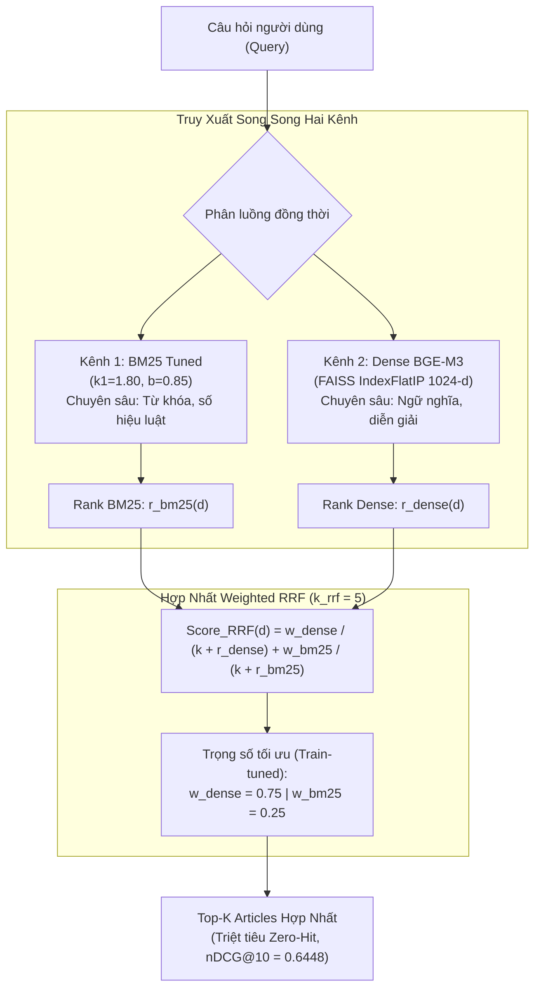

# Phase 11: Hybrid Retrieval (Weighted Reciprocal Rank Fusion)

## 1. Nhiệm vụ cốt lõi (Làm gì?)
Hợp nhất sức mạnh của hai phương pháp truy xuất bổ trợ lẫn nhau: **Sparse Lexical Search (BM25 Tuned)** và **Dense Semantic Search (BGE-M3)** nhằm xây dựng bộ truy xuất tối ưu toàn diện (**Production Retriever Champion**):
* **Mục tiêu:** Khắc phục nhược điểm "ảo giác vị trí" của vector dày đặc khi gặp số hiệu văn bản cụ thể, đồng thời xóa bỏ rào cản "hố sâu từ vựng" của tìm kiếm từ khóa.
* **Đầu vào:** `corpus_articles_preprocessed.parquet` (59.636 điều luật), `retrieval_train.json` (1.752 queries), `retrieval_test.json` (438 queries).
* **Đầu ra:** Mô hình `HybridRetriever` với thuật toán **Weighted Reciprocal Rank Fusion (wRRF)** và báo cáo nghiệm thu chính thức.

---

## 2. Kiến trúc & Giải thuật Hợp nhất (Architecture & Fusion Algorithm)



### Cơ sở toán học của Weighted Reciprocal Rank Fusion:
Điểm số hợp nhất của tài liệu $d$ được tính theo công thức:
$$\text{Score}_{\text{wRRF}}(d) = w_{\text{dense}} \cdot \frac{1}{k_{\text{rrf}} + r_{\text{dense}}(d)} + w_{\text{bm25}} \cdot \frac{1}{k_{\text{rrf}} + r_{\text{bm25}}(d)}$$
* $k_{\text{rrf}} = 5$: Hằng số làm mịn thứ hạng. Giá trị $k$ nhỏ ưu tiên cao cho các tài liệu lọt vào Top-3 của từng kênh.
* $w_{\text{dense}} = 0.75$: Tận dụng 75% ưu thế hiểu sâu ngữ nghĩa tự nhiên của mô hình ngôn ngữ BGE-M3.
* $w_{\text{bm25}} = 0.25$: Bổ sung 25% tín hiệu khớp chính xác số hiệu văn bản (ví dụ: *"Khoản 2 Điều 4 Thông tư 12"*).
* $r(d) \in [1, K]$: Thứ tự xếp hạng của tài liệu $d$ trong danh sách ứng viên (nếu không xuất hiện, gán $r(d) = \infty$).

---

## 3. Hiện thực Code (Dùng gì & Ở đâu?)

### A. Danh mục Modules & Scripts
| Thành phần | Đường dẫn File | Công nghệ / Thuật toán | Vai trò |
|---|---|---|---|
| Thuật toán Weighted RRF | `src/retrieval/hybrid/fusion.py` | `numpy`, Reciprocal Rank | Hàm tính toán điểm số wRRF và sắp xếp kết quả |
| Hybrid Retriever Class | `src/retrieval/hybrid/retriever.py` | `BaseRetriever` | Lớp bọc kết hợp BM25 + BGE-M3 thành một giao diện duy nhất |
| Tinh chỉnh siêu tham số | `scripts/retrieval/tune_hybrid.py` | Quét lưới grid search | Tìm $k=5, w_d=0.75, w_b=0.25$ trên tập Train (1.752 queries) |
| Đánh giá nghiệm thu | `scripts/evaluation/evaluate_hybrid.py` | `json`, IR metrics | Đo lường chính thức trên Frozen Test Set (438 queries) |

### B. Trích đoạn API sử dụng chuẩn
```python
from src.retrieval.hybrid.retriever import HybridRetriever

# Khởi tạo retriever hỗn hợp với cấu hình tối ưu
retriever = HybridRetriever(
    dense_retriever=dense_retriever_instance,
    bm25_retriever=bm25_retriever_instance,
    k_rrf=5,
    w_dense=0.75,
    w_bm25=0.25
)

# Thực thi tìm kiếm hợp nhất
results = retriever.search("Thời gian đóng bảo hiểm xã hội để hưởng lương hưu", top_k=10)
```

---

## 4. Kết quả & Đánh giá (Metrics & Takeaways)

### A. Bảng đối chuẩn toàn diện trên Frozen Hold-out Test (438 queries)

| Hệ thống Truy xuất | P@10 | Recall@10 | Recall@100 | MRR@10 | MAP@10 | nDCG@10 | nDCG@100 | Zero-hit@10 | Zero-hit@100 | Độ trễ (Latency) |
|---|:---:|:---:|:---:|:---:|:---:|:---:|:---:|:---:|:---:|:---:|
| **BM25 Tuned** | 0.0817 | 0.6671 | 0.8727 | 0.4610 | 0.4114 | 0.4866 | 0.5339 | 112 (25.6%) | 34 (7.8%) | **3.26 ms** |
| **Dense BGE-M3** | 0.0982 | 0.7969 | 0.9441 | 0.6146 | 0.5520 | 0.6277 | 0.6634 | 57 (13.0%) | 9 (2.1%) | 17.50 ms |
| **Hybrid Weighted RRF** | **0.0986** | **0.8013** | **0.9540** | **0.6366** | **0.5722** | **0.6448** | **0.6821** | **54 (12.3%)** | **7 (1.6%)** | **4.07 ms** |
| *Cải thiện so với Dense* | *+0.4%* | *+0.6%* | *+1.0%* | *+3.6%* | *+3.7%* | **+2.7%** | **+2.8%** | **-5.3%** | **-22.2%** | *Rất nhanh* |
| *Cải thiện so với BM25* | *+20.7%* | *+20.1%* | *+9.3%* | *+38.1%* | *+39.1%* | **+32.5%** | **+27.8%** | **-51.8%** | **-79.4%** | *Tương đương* |

### B. Hai Đóng Góp Kỹ Thuật Mang Tính Quyết Định:
1. **Triệt tiêu Thất bại Hoàn toàn (Zero-Hit Reduction):**
   * Ở mức Top-100, Dense baseline bỏ sót 9 câu hỏi, BM25 bỏ sót 34 câu hỏi. Hybrid giảm số câu thất bại xuống chỉ còn **7 câu duy nhất** (tỷ lệ thành công 98.4%).
   * Điều này mang ý nghĩa sống còn cho pipeline RAG: nếu tài liệu không lọt vào Top-100 của retriever, các bước tiếp theo (Reranker hoặc LLM) hoàn toàn không có cơ hội tiếp cận tri thức đúng.
2. **Xác lập Production Retriever Champion:**
   * Với điểm số **nDCG@10 = 0.6448** và thời gian truy vấn chỉ **4.07 ms/query**, Hybrid Weighted RRF được đóng băng chính thức làm **Bộ sinh ứng viên Tầng 1 (First-Stage Retriever)** cho toàn bộ hệ thống phục vụ sản xuất.
