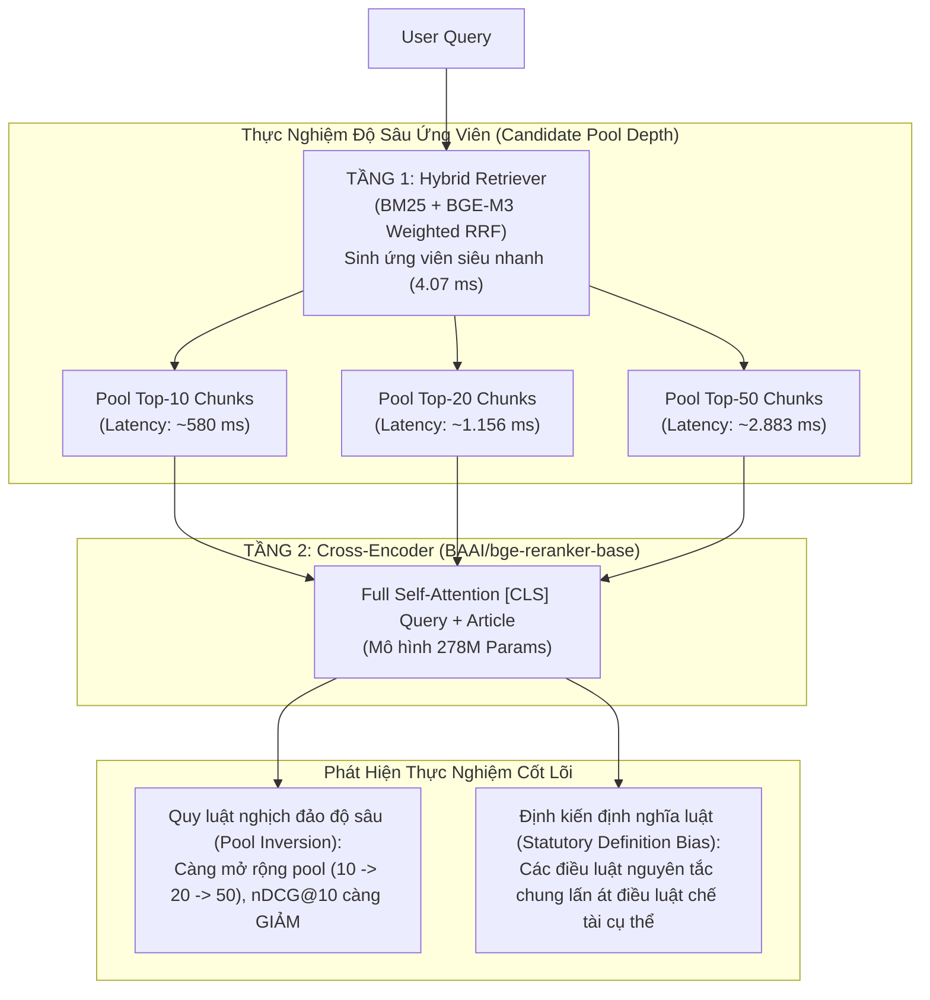

# Phase 12: Cross-Encoder Reranking & Depth Scaling Analysis

## 1. Nhiệm vụ cốt lõi (Làm gì?)
Nghiên cứu và đánh giá thực nghiệm việc tích hợp mô hình tái xếp hạng Tầng 2 (**Cross-Encoder Reranker**) nhằm tinh chỉnh thứ tự các ứng viên được trả về từ bộ truy xuất hỗn hợp (Phase 11 Hybrid Retriever):
* **Mục tiêu:** Kiểm chứng xem cơ chế Full Cross-Attention giữa cặp câu hỏi – điều luật có giúp cải thiện thứ hạng Top-10 và chất lượng ngữ cảnh phục vụ RAG hay không.
* **Mô hình thử nghiệm:** `BAAI/bge-reranker-base` (278M tham số, XLM-RoBERTa backbone, FP16 CUDA).
* **Đầu vào:** Tập ứng viên (Candidate Pool) từ Hybrid Retriever (Top-10, Top-20, Top-50) trên 438 câu hỏi Frozen Test.
* **Đầu ra:** Báo cáo phân tích hiện tượng suy giảm ngữ nghĩa (Negative Dilution), đánh đổi độ trễ tính toán, và quyết định kiến trúc sản xuất.

---

## 2. Kiến trúc Hai Tầng & Hiện tượng Suy giảm Ngữ nghĩa (Architecture & Trade-offs)



---

## 3. Hiện thực Code (Dùng gì & Ở đâu?)

### A. Danh mục Modules & Scripts
| Thành phần | Đường dẫn File | Công nghệ / Mô hình | Vai trò |
|---|---|---|---|
| Reranker Core | `src/retrieval/reranking/reranker.py` | `FlagEmbedding.FlagReranker`, PyTorch | Lớp bọc tính toán điểm Cross-Encoder theo batch |
| Reranker Adapter cho RAG | `src/rag/reranking/adapters/cross_encoder_reranker.py` | `src.rag.reranking` interface | Adapter tích hợp mô hình reranker vào pipeline RAG |
| Script đánh giá đa cấu hình | `scripts/evaluation/evaluate_reranker.py` | `torch.cuda`, `json` | Đánh giá scaling Top-10, Top-20, Top-50 trên Test set |
| Unit Tests | `tests/test_reranker.py` | `unittest` | Kiểm thử tính ổn định, fallback khi rỗng và định dạng output |

### B. Trích đoạn API sử dụng
```python
from src.retrieval.reranking.reranker import CrossEncoderReranker

# Khởi tạo Cross-Encoder với model pretrained BAAI
reranker = CrossEncoderReranker(
    model_name_or_path="BAAI/bge-reranker-base",
    device="cuda",
    use_fp16=True
)

# Tái xếp hạng danh sách ứng viên từ Hybrid Retriever
reranked_results = reranker.rerank(
    query="Thủ tục ly hôn đơn phương gồm những giấy tờ gì?",
    candidates=hybrid_candidate_articles,
    top_k=5
)
```

---

## 4. Kết quả & Đánh giá (Metrics & Takeaways)

### A. Bảng đối so sánh các cấu hình Reranker trên Frozen Test Set (438 queries)

| Hệ thống / Cấu hình | nDCG@10 | MRR@10 | Recall@5 | Recall@10 | Precision@5 | Zero-hit@10 | Độ trễ (Latency) | Thông lượng (QPS) |
|---|:---:|:---:|:---:|:---:|:---:|:---:|:---:|:---:|
| **Hybrid Weighted RRF (Phase 11)** | **0.6448** | **0.6366** | **0.7273** | **0.8013** | **0.1763** | **12.33%** | **4.07 ms** | **245.7 QPS** |
| **Hybrid + Reranker (Top-10 Pool)** | 0.6096 | 0.5885 | 0.6856 | **0.8013** | 0.1639 | **12.33%** | 579.87 ms | 1.72 QPS |
| **Hybrid + Reranker (Top-20 Pool)** | 0.5830 | 0.5656 | 0.6396 | 0.7659 | 0.1539 | 15.53% | 1,155.66 ms | 0.87 QPS |

### B. Đánh đổi Độ sâu Ứng viên (Candidate Pool Scaling trên 100 queries chuẩn):
* **Top-10 Pool:** nDCG@10 = **0.6826** | Latency = 579.9 ms
* **Top-20 Pool:** nDCG@10 = **0.6358** | Latency = 1,155.7 ms
* **Top-50 Pool:** nDCG@10 = **0.6026** | Latency = 2,883.1 ms

### C. Ba Phát Hiện Khoa Học & Quyết Định Sản Xuất:
1. **Hiện tượng Suy giảm khi Mở rộng Pool (Negative Dilution):**
   * Khi mở rộng pool từ 10 lên 50, các điều luật ở vị trí sâu (21–50) chứa nhiều từ vựng giải thích chung chung (*"Điều 1. Phạm vi điều chỉnh", "Điều 3. Giải thích từ ngữ"*) nhận điểm cross-attention bề mặt rất cao, lấn át và đẩy các điều luật ground-truth cụ thể ra khỏi Top-10.
2. **Chi phí thời gian thực không khả thi:**
   * Độ trễ tăng từ 4.07 ms lên gần 3.000 ms (gấp hơn 700 lần). Với hệ thống tư vấn phục vụ tương tác thực tế, đây là nút thắt cổ chai rất lớn nếu không có cụm GPU cấp độ datacenter.
3. **Quyết định Kiến trúc Sản xuất (Production Decision):**
   * **Hybrid Retrieval (Weighted RRF)** tiếp tục được chọn làm **Production Retriever** chính thức nhờ sự tối ưu tuyệt đối: nDCG@10 cao nhất (0.6448) và độ trễ siêu nhanh (4.07 ms).
   * Reranker Cross-Encoder được lưu trữ như một thành phần module tùy chọn và cần được Fine-tune chuyên biệt với Hard Negatives tiếng Việt trước khi đưa vào luồng chính.
