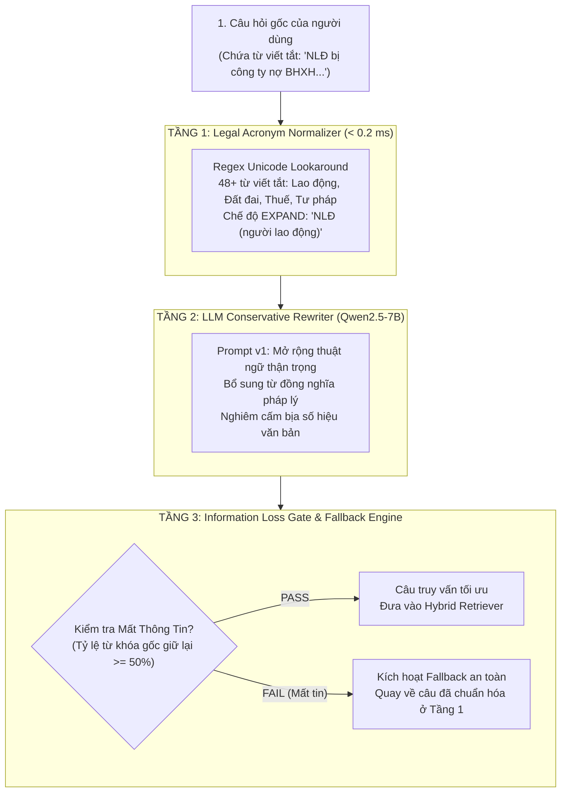

# Phase 13: Query Processing & Legal Terminology Expansion

## 1. Nhiệm vụ cốt lõi (Làm gì?)
Xây dựng pipeline tiền xử lý và mở rộng câu truy vấn chuyên sâu cho ngôn ngữ pháp lý Việt Nam:
* **Mục tiêu:** Cầu nối từ vựng thông tục (Vernacular Query) của người dân sang thuật ngữ luật định (Statutory Terms), giải mã các từ viết tắt chuyên ngành, và bảo vệ ý định người dùng bằng cổng chống mất thông tin (**Information Loss Gate**).
* **Đầu vào:** Câu hỏi gốc của người dùng (chứa tiếng lóng, từ viết tắt như `NLĐ`, `BHXH`, `QSDĐ`).
* **Đầu ra:** Câu truy vấn đã chuẩn hóa và làm giàu thuật ngữ pháp lý, tối ưu hóa cho bộ tìm kiếm kết hợp (Phase 11 Hybrid Retriever).

---

## 2. Kiến trúc Đường ống Xử lý 3 Tầng (Three-Stage Pipeline Architecture)

---

## 3. Hiện thực Code (Dùng gì & Ở đâu?)

### A. Danh mục Modules & Cấu hình trong `src/rag/query/`
| Thành phần | Đường dẫn File | Công nghệ / Thuật toán | Vai trò |
|---|---|---|---|
| Acronym Normalizer | `src/rag/query/normalizer.py` | Regex Unicode Lookaround | Tra cứu và mở rộng 48+ từ viết tắt pháp lý siêu tốc ($\approx 0.15$ ms) |
| LLM Query Rewriter | `src/rag/query/rewriter.py` | `Qwen2.5-7B-Instruct`, JSON parsing | Mở rộng từ khóa pháp quy, kiểm tra độ dài và rủi ro bịa luật |
| Unified Coordinator | `src/rag/query/processor.py` | Orchestrator & Fallback logic | Điều phối 3 tầng xử lý, tính latency, quản lý cổng Information Loss |
| Data Models | `src/rag/query/models.py` | `dataclasses` | Định nghĩa `ProcessedQuery`, `ProcessingMetadata`, `FailureType` |
| Prompt Template | `configs/prompts/query_rewriter_v1.json` | JSON Prompt Configuration | Chỉ dẫn LLM mở rộng có kiểm soát |
| Colab GPU Runner | `scripts/evaluation/run_phase13_colab.py` `notebooks/phase13_colab_runner.ipynb` | Google Drive mount, Colab GPU | Môi trường chạy thực nghiệm phân tán trên GPU |

### B. Từ điển 48+ từ viết tắt pháp lý trọng điểm (`normalizer.py`)
* **Lao động & Xã hội:** `NLĐ`/`NLD` $\to$ *người lao động*, `NSDLĐ` $\to$ *người sử dụng lao động*, `BHXH` $\to$ *bảo hiểm xã hội*, `BHYT` $\to$ *bảo hiểm y tế*, `HĐLĐ` $\to$ *hợp đồng lao động*, `TNLĐ` $\to$ *tai nạn lao động*.
* **Đất đai & Bất động sản:** `QSDĐ` $\to$ *quyền sử dụng đất*, `GCNQSDĐ` $\to$ *giấy chứng nhận quyền sử dụng đất (sổ đỏ)*, `BĐS` $\to$ *bất động sản*, `VPĐKĐĐ` $\to$ *văn phòng đăng ký đất đai*.
* **Tài chính & Thuế:** `TNCN` $\to$ *thuế thu nhập cá nhân*, `TNDN` $\to$ *thuế thu nhập doanh nghiệp*, `GTGT` $\to$ *giá trị gia tăng*, `TCTD` $\to$ *tổ chức tín dụng*, `NHNN` $\to$ *ngân hàng nhà nước*.
* **Cơ quan & Tư pháp:** `VPHC` $\to$ *vi phạm hành chính*, `PCCC` $\to$ *phòng cháy chữa cháy*, `CSGT` $\to$ *cảnh sát giao thông*, `UBND` $\to$ *ủy ban nhân dân*, `TAND` $\to$ *tòa án nhân dân*, `VKSND` $\to$ *viện kiểm sát nhân dân*.

---

## 4. Cơ chế Phòng vệ & Quản lý Thất bại (Failure Taxonomy)

Hệ thống thiết lập 4 cơ chế bảo vệ nghiêm ngặt chống suy thoái câu hỏi:
1. **Chế độ Mở rộng Bảo tồn (EXPAND Mode):**
   * Thay vì thay thế đè chuỗi (`NLĐ` $\to$ `"người lao động"`), normalizer áp dụng định dạng `"NLĐ (người lao động)"`. Nhờ đó, BM25 vẫn giữ được điểm khớp từ viết tắt nguyên bản nếu điều luật có viết tắt, trong khi Dense BGE-M3 nắm bắt được ngữ nghĩa đầy đủ.
2. **Information Loss Gate (< 50% Threshold):**
   * Nếu câu viết lại của LLM vô tình bỏ sót các thực thể quan trọng (ví dụ câu gốc hỏi về *"UBND Quận Ba Đình"* nhưng câu mới chỉ nói chung chung là *"cơ quan nhà nước"*), tỷ lệ trùng lặp từ vựng rơi xuống dưới 50% $\rightarrow$ Hệ thống tự động hủy kết quả của LLM và kích hoạt Fallback về kết quả của Tầng 1.
3. **Chống Bịa đặt Điều luật (Hallucination Prevention):**
   * Prompt hệ thống nghiêm cấm LLM tự ý chèn các số hiệu văn bản cụ thể (ví dụ cấm tự thêm *"Theo Nghị định 100/2019/NĐ-CP"*). Nếu câu gốc không nêu rõ số hiệu, câu viết lại chỉ được phép mở rộng về mặt khái niệm hành vi pháp lý.
