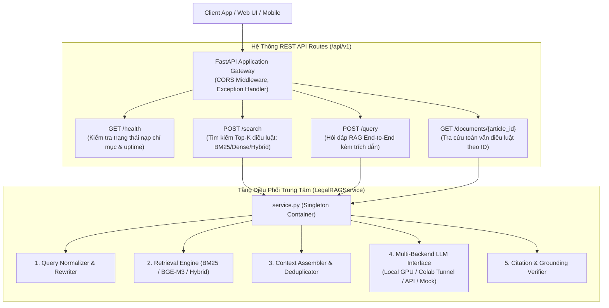

# Phase 14: API Backend & Serving Architecture (FastAPI Service)

## 1. Nhiệm vụ cốt lõi (Làm gì?)
Đóng gói toàn bộ các cấu phần thuật toán và đường ống RAG thành một dịch vụ Web API RESTful chuẩn công nghiệp, sẵn sàng cho việc đóng gói Docker và triển khai hạ tầng (Deployment):
* **Mục tiêu:** Cung cấp các giao diện lập trình ứng dụng (RESTful Endpoints) hiệu năng cao cho các ứng dụng client (Web UI, Mobile, Chatbot) tương tác: kiểm tra tình trạng hệ thống, tìm kiếm văn bản pháp luật độc lập, và hỏi đáp tư vấn pháp luật tự động kèm trích dẫn căn cứ.
* **Đầu vào:** HTTP Requests (JSON payload) từ phía người dùng/ứng dụng.
* **Đầu ra:** HTTP Responses (JSON payload) chuẩn hóa tuân thủ nghiêm ngặt các schema Pydantic.

---

## 2. Kiến trúc Hệ thống Phục vụ (Serving Architecture)



---

## 3. Hiện thực Code (Dùng gì & Ở đâu?)

Toàn bộ mã nguồn phục vụ backend được đặt tại thư mục [`src/api/`](file:///d:/PROJECT/PROJECT%202/src/api/):

### A. Danh mục Modules & Trách nhiệm
| File | Công nghệ chính | Trách nhiệm kiến trúc |
|---|---|---|
| `src/api/main.py` | `FastAPI`, `uvicorn`, CORS Middleware | Điểm khởi chạy ứng dụng, cấu hình routing, vòng đời `lifespan` |
| `src/api/routes.py` | `APIRouter`, `Depends` | Định nghĩa các HTTP endpoints, dependency injection container |
| `src/api/schemas.py` | `pydantic.BaseModel` | Đặc tả hợp đồng dữ liệu Request & Response chặt chẽ |
| `src/api/service.py` | `LegalRAGService` | Singleton Service nạp lazy-load các chỉ mục và điều phối RAG |
| `tests/test_api.py` | `fastapi.testclient.TestClient` | Bộ kiểm thử tự động toàn bộ luồng API |

### B. Chi tiết các Endpoints Chính thức

#### 1. `GET /api/v1/health`
Kiểm tra sức khỏe hệ thống và trạng thái nạp bộ nhớ của các chỉ mục:
* **Response:**
```json
{
  "status": "healthy",
  "version": "1.0.0",
  "total_articles": 59636,
  "indices_loaded": {
    "bm25": true,
    "dense": true,
    "reranker": false
  },
  "default_backend": "auto",
  "uptime_seconds": 128.45
}
```

#### 2. `POST /api/v1/search`
Tìm kiếm độc lập văn bản điều luật với tùy chọn thuật toán linh hoạt:
* **Payload:**
```json
{
  "query": "thời hiệu khởi kiện tranh chấp lao động",
  "retriever_type": "hybrid",
  "top_k": 5
}
```
* **Supported `retriever_type`:** `"bm25"`, `"dense"`, `"hybrid"`, `"rerank"`.

#### 3. `POST /api/v1/query`
Đường ống hỏi đáp pháp lý End-to-End RAG hoàn chỉnh:
* **Payload:**
```json
{
  "query": "Người lao động thử việc có phải đóng bảo hiểm xã hội không?",
  "backend": "auto",
  "top_k": 5,
  "temperature": 0.0
}
```
* **Response Schema (`QueryResponse`):** Chứa câu trả lời giải thích chi tiết, đánh giá độ tự tin (`HIGH`/`MEDIUM`/`LOW`), danh sách điều luật trích dẫn nguồn gốc, và thời gian trễ thực thi `latency_ms`.

#### 4. `GET /api/v1/documents/{article_id}`
Truy vấn trực tiếp toàn văn và siêu dữ liệu hành chính của một điều luật theo mã `global_article_id` (từ `0` đến `59635`).

---

## 4. Thiết kế Linh hoạt Đa Backend (Multi-Backend Support)

Để tối ưu hóa triển khai trên nhiều môi trường phần cứng khác nhau (máy cá nhân không có GPU khủng, hoặc máy chủ cloud), `LegalRAGService` hỗ trợ cơ chế chuyển mạch backend tự động:
1. **`colab` / `colab_tunnel`:** Kết nối tới tunnel GPU Google Colab chạy mô hình `Qwen2.5-7B-Instruct` thông qua ngrok / Cloudflare Tunnel.
2. **`local`:** Sử dụng thư viện transformers nạp trực tiếp mô hình vào VRAM card đồ họa máy chủ.
3. **`mock`:** Phục vụ môi trường kiểm thử CI/CD tự động, trả về câu trả lời giả lập mà không tốn tài nguyên GPU.
4. **`openai_compatible`:** Kết nối tới các endpoint chuẩn OpenAI (như vLLM, Ollama, LiteLLM).

---

## 5. Chuẩn bị cho Giai đoạn Đóng gói Docker & Triển khai
* Ứng dụng được thiết kế hoàn toàn Stateless, sẵn sàng đóng gói trong Docker Container.
* Lệnh khởi chạy tiêu chuẩn:
```bash
uvicorn src.api.main:app --host 0.0.0.0 --port 8000 --workers 1
```
