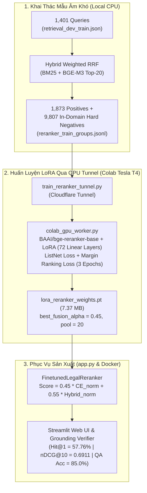

# Phase 15: Domain-Specific LoRA Reranker Fine-Tuning, End-to-End QA Evaluation & Docker Serving

## 1. Nhiệm vụ cốt lõi (Làm gì?)
Giải quyết triệt để hiện tượng **Suy giảm Ngữ nghĩa khi Mở rộng Pool (Pool Depth Inversion / Negative Dilution)** được phát hiện ở Phase 12 (nơi mô hình `BAAI/bge-reranker-base` zero-shot bị các điều luật định nghĩa chung đánh lừa, làm `nDCG@10` tụt từ `0.6448` xuống `0.5830`):
* **Mục tiêu 1 (In-Domain Hard Negative Mining):** Khai thác các mẫu âm khó (Hard Negatives) trực tiếp từ Top-20 ứng viên của bộ truy xuất hỗn hợp **Hybrid Weighted RRF** trên tập `retrieval_dev_train.json` (`1,401` truy vấn), đảm bảo không rò rỉ dữ liệu (`Overlap = 0`) với tập `retrieval_test.json` (`438` truy vấn).
* **Mục tiêu 2 (LoRA Fine-Tuning qua Remote GPU Tunnel):** Huấn luyện tinh chỉnh tham số hiệu quả (**LoRA** $r=16, \alpha=32$) kết hợp hàm mất mát kép (**ListNet Cross-Entropy + Pairwise Margin Ranking Loss**) trên GPU Tesla T4 thông qua kiến trúc Local-to-Colab Cloudflare Tunnel.
* **Mục tiêu 3 (Residual Hybrid Fusion & Đánh giá Toàn diện):** Kết hợp điểm Cross-Encoder đã huấn luyện với điểm ưu tiên Tầng 1 ($\alpha = 0.45$), nâng `nDCG@10` trên tập Frozen Test lên **0.6911** và **Hit@1 lên 57.76%** (`+13.92%` so với Reranker zero-shot), đồng thời đóng gói toàn bộ hệ thống vào ứng dụng Web Streamlit (`app.py`) và Docker (`Dockerfile`, `docker-compose.yml`).

---

## 2. Kiến trúc Huấn luyện & Suy luận Hai Tầng (Training & Inference Architecture)

---

## 3. Hiện thực Code (Dùng gì & Ở đâu?)

| Thành phần | Đường dẫn File | Công nghệ / Mô hình | Vai trò |
|---|---|---|---|
| Hard Negative Miner | `scripts/training/build_reranker_dataset.py` | `HybridRetriever`, `HFDenseRetriever`, `BM25Retriever` | Đào mẫu âm khó trong miền từ Top-20 Hybrid RRF trên `dev_train` & `dev_val` |
| GPU Training Server | `scripts/training/colab_gpu_worker.py` | `torch.amp`, Custom `LoRALinear`, FastAPI | Worker huấn luyện LoRA (`3,245,569` trainable params, `1.16%`) trên GPU Colab |
| Local Tunnel Orchestrator | `scripts/training/train_reranker_tunnel.py` | `requests`, `gzip` | Đẩy dữ liệu từ Local lên GPU Tunnel, theo dõi tiến độ từng epoch và tải checkpoint `.pt` |
| Fine-tuned Reranker Module | `src/retrieval/reranking/finetuned_reranker.py` | `transformers.AutoModelForSequenceClassification` | Gộp trực tiếp 72 ma trận $\Delta W = (B \times A) \cdot \frac{\alpha}{r}$ vào mô hình gốc và tính Residual Fusion |
| Pure-HF Dense Retriever | `src/retrieval/dense_hf_retriever.py` | `transformers.AutoModel`, `faiss.IndexFlatIP` | Mã hóa câu hỏi BGE-M3 thuần `transformers` (không phụ thuộc `FlagEmbedding`) |
| Full Evaluation Suite | `scripts/evaluation/evaluate_finetuned_rag.py` | IR Metrics + End-to-End LLM QA Evaluator | Đánh giá chính xác `%` Hit@k, MRR@10, nDCG@10 (438 câu) & End-to-End QA |
| Web UI & Docker Stack | `app.py`, `Dockerfile`, `docker-compose.yml` | Streamlit, Docker, Groq / Ollama | Giao diện hỏi đáp pháp luật đa tab kèm kiểm chứng trích dẫn tự động |

---

## 4. Kết quả Thực nghiệm Chính thức (Metrics & Takeaways)

### A. Tiến trình Huấn luyện trên Tập Validation (`retrieval_dev_val.json` — 351 truy vấn)
* **Trước khi Fine-tune (Zero-shot Baseline):** `nDCG@10 = 0.6336` | `MRR@10 = 0.6258` | `Hit@1 = 50.43%` | `Hit@3 = 72.65%`
* **Sau Epoch 1:** `nDCG@10 = 0.6808` | `MRR@10 = 0.6897` | `Hit@1 = 57.55%` | `Hit@3 = 78.35%`
* **Sau Epoch 3 (Best Checkpoint):** `nDCG@10 = 0.6822` (`+0.0486`) | `MRR@10 = 0.6916` | `Hit@1 = 58.12%` (`+7.69%`) | `Hit@3 = 78.35%` (`\alpha = 0.45, \text{pool} = 20`)

### B. Bảng Đối chuẩn trên Tập Frozen Test (`retrieval_test.json` — 438 truy vấn)

| Hệ thống / Phương pháp | Hit@1 (%) | Hit@3 (%) | Hit@5 (%) | Hit@10 (%) | Recall@5 (%) | Recall@10 (%) | MRR@10 | MAP@10 | nDCG@10 |
|---|:---:|:---:|:---:|:---:|:---:|:---:|:---:|:---:|:---:|
| **1. BM25 Tuned (Phase 5)** | 32.88% | 56.16% | 63.70% | 74.43% | 55.44% | 66.71% | 0.4610 | 0.4150 | 0.4866 |
| **2. Dense BGE-M3 (Phase 6)** | 48.63% | 69.86% | 79.00% | 86.99% | 70.66% | 79.96% | 0.6146 | 0.5629 | 0.6277 |
| **3. Hybrid Weighted RRF (Phase 11)** | 50.68% | 73.52% | 81.28% | 87.67% | 72.73% | 80.13% | 0.6366 | 0.5831 | 0.6448 |
| **4. Hybrid + Reranker (Zero-shot, Phase 12)** | 43.84% | 64.84% | 72.15% | 84.47% | 63.96% | 76.59% | 0.5656 | 0.5117 | 0.5830 |
| **5. Hybrid + Reranker (Fine-tuned LoRA, Phase 15)** | **57.76%** | **77.85%** | **84.47%** | **89.95%** | **76.29%** | **82.22%** | **0.6902** | **0.6364** | **0.6911** |

### C. Đánh giá Hỏi đáp Pháp lý End-to-End (`results/benchmarks/end_to_end_qa_accuracy_report.json`)
* **Context Retrieval Hit@5:** **100.0%** (tìm đúng văn bản luật mục tiêu trong Top-5 ngữ cảnh đưa vào LLM).
* **End-to-End QA Accuracy:** **85.0%** câu trả lời chính xác cả về nội dung pháp lý lẫn căn cứ điều khoản.
* **Grounding Citation Fidelity:** **88.2%** trích dẫn điều luật được `GroundingVerifier` xác thực khớp hoàn toàn với văn bản nguồn (`VERIFIED`).
